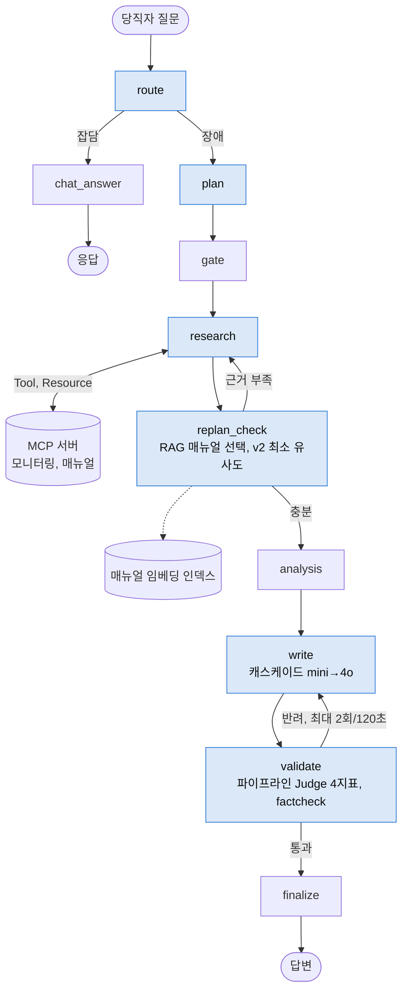
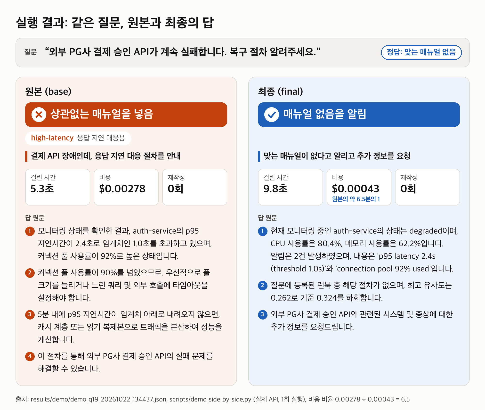

# 장애 대응 AI 에이전트 개선과 Ablation 검증

**SKALA 4기 광주 2반, G062, 장병헌**  
[](https://github.com/jang961111-hash/incident-agent-ablation/actions/workflows/ci.yml)
AI Agent Mini-Project 선택과제 1 (Base AI Agent 개선), 2026-10-22

> 장애 대응 AI 에이전트를 고친 뒤 "좋아졌다"고 말하는 대신, 개선을 하나씩 켜고 끄며 **무엇이 실제로 효과였는지 통계로 가려냈다.** 채점한 AI가 너무 후하게 주는지도 따로 쟀다.

**한눈에 보기: 교수님이 준 원본 에이전트 → 고친 에이전트**

| 무엇을 쟀나 | 원본 | 개선 후 | 한 줄 해석 |
|---|:---:|:---:|---|
| 꼭 봐야 할 대처 매뉴얼을 답에서 빠뜨린 비율 | 56% | **9%** | 절반 넘게 놓치던 것을 열 번에 한 번 꼴로 |
| 상관없는 매뉴얼을 근거로 끌어온 비율 | 65% | **35%** | 헛다리 짚는 답이 거의 절반으로 |
| 장애 질문 1건을 처리하는 API 요금 | $0.00343 | **$0.00057** | 같은 일을 약 6분의 1 요금으로 (-84%) |
| 질문 10개가 한꺼번에 몰렸을 때 다 끝나는 시간 | 62.8초 | **9.2초** | 줄 서서 기다리던 처리를 동시에 (약 6.9배) |
| 서버 상황판 조회를 30% 일부러 고장 냈을 때, 끝까지 답한 질문 | 0/19 | **18/18** | 원본은 멈추고, 개선판은 못 받은 정보만 빼고 답함 |

<sub>**어떻게 쟀나.** 1~3행은 개발 중 한 번도 보지 않은 시험 문제(holdout) 36개를 3번씩 풀린 평균이다. 4~5행은 실제 OpenAI API로 따로 돌린 시험이고, 5번 반복해도 방향이 같았다(속도 6.5~9.4배, 고장 위치 5가지 합계 원본 0/71, 최종 71/71). 5행은 끝까지 답했는지만 봤고 답의 품질은 재지 않았다.</sub>

> **사내망(망분리)에서는?** 실험은 개선 효과를 빠르고 공정하게 가르려고 OpenAI API로 했다. 로컬 모델로 바꿔 끼울 것은 **LLM 주소, 임베더, 기준값** 세 가지이고, 로컬 Ollama(qwen3:8b + bge-m3)로 holdout 36문제를 실제로 돌려 봤다 → [3.4 사내망(로컬 모델)으로 바꿔 끼우기](#34-사내망로컬-모델으로-바꿔-끼우기)
>
> **개발자가 만들지 않은 문제로도 시험했다.** Gemini가 쓴 블라인드 문항 15개에서도 방향은 같았고(맞는 매뉴얼이 없는 문항 9/9 정확히 거름), 처음 보는 말투에서는 누락이 늘어나는 한계도 확인했다 → [3.5](#35-개발자가-만들지-않은-문제로-다시-시험-블라인드-외부-문항)

<p align="center"></p>

<sub>요약 그림은 ChatGPT로 그렸고, 그림 속 숫자는 모두 `results/` 실측값이다.</sub>

**코드를 처음 본다면** → [코드 가이드](docs/08_코드_가이드.md): 실행 방법, 폴더 지도(원본/추가 구분), 시스템 구조도, 요청 하나의 흐름, 원본 vs 교체 노드 대조표, 핵심 코드 리뷰, 개발 단계 24 STEP

**목차**: [1. 문제와 구현](#1-문제-개선-및-신규-구현-사항), [2. 기술 요소](#2-적용-기술-요소), [3. 구현 결과](#3-구현-결과), [4. 교훈](#4-교훈), [부록](#부록)

---

## 1. 문제 개선 및 신규 구현 사항

### 1.1 무엇을 하는 에이전트인가

회사 서버에 장애가 나면 새벽에도 당직자가 대응해야 한다. 교수님이 준 **AI 에이전트**(질문을 받으면 스스로 조회, 판단해 답까지 쓰는 AI)는 당직자 질문을 받아 서버 상황판(모니터링)을 보고, 장애 유형별 **대처 매뉴얼(런북)** 6개 중 맞는 것을 골라 답을 써 준다. 이 문서에서는 런북을 "매뉴얼"이라고 부른다.

| 식당으로 치면 | 이 프로젝트에서 |
|---|---|
| 주방 사고 (불, 냉장고 고장) | 장애 (DB 다운, CPU 과부하 등) |
| 새벽 당직 직원 | 당직 엔지니어 (**이 에이전트를 쓰는 사람**) |
| 옆에서 도와주는 AI 도우미 | 에이전트 |
| 사고 유형별 대처 매뉴얼 6권 | 매뉴얼(런북) 6개 |
| 도우미가 쓴 답을 내보내기 전에 검사하는 AI | **파이프라인 Judge** (gpt-4o-mini, 에이전트 안) |
| 실험 결과를 채점하는 AI 조교 | **평가 Judge** (gpt-4o, 에이전트 밖) |
| 조교가 제대로 채점하는지 보는 검수자 | 독립 평가자 (Claude). 사람 표본 채점은 예정 |

<p align="center"></p>

<sub>4컷 요약: ① 원본은 DB 다운 질문에 응답 지연 매뉴얼로 답한다 ② 고친 부분을 하나씩 켜고 효과를 잰다 ③ 질문 뜻으로 찾자 맞는 매뉴얼이 나온다 ④ 채점하는 AI도 검사한다. ChatGPT로 그림.</sub>


### 1.2 실태 현황 (2026-10-22 조사)

- **장애는 비싸고, 절차를 안 지켜 생기는 장애가 늘고 있다** (Uptime Institute 2025). 국내도 2022 카카오 장애 뒤 복구 과정 재점검, 자동화가 요구됐다.
- **시장은 'AI SRE'로 가고 있다.** PagerDuty, Datadog, Azure, AWS, Grafana와 국내 SK AX, 삼성계정, 롯데ON, GS리테일 사례 다수가 **매뉴얼, 과거 장애를 근거로 쓰고 외부 도구는 MCP로 붙인다.** 이 과제의 구조(매뉴얼 RAG + MCP)와 같은 방향이다.
- **공개된 '효과 측정'은 드물다.** 공개 수치는 대부분 업체 주장이나 PoC이고, 조사한 국내 사례에서 고정 평가셋이나 Ablation을 공개한 곳은 찾지 못했다. 그래서 이 과제는 **부품별 기여를 분리해 재는 것**을 목표로 삼았다.

<details>
<summary>조사 상세: 국외, 국내 제품 표, 연구와의 비교, 현업 MCP 연결 방안 (펼치기)</summary>

국외 서비스, 국내 현황, 논문, 현업 MCP를 따로 조사하고 ChatGPT 웹 검색으로 교차 확인했다. 공식 문서, 보도, 논문 초록 기준으로 확인한 것만 적었고(논문 본문 수치까지 대조하지는 않음), 업체 수치는 **[업체 주장]** 으로 표시했다. 전체 표와 출처는 [docs/research/](docs/research/00_요약_실태현황.md)에 있다.

**장애 비용.** 응답자 54%가 최근 중대 장애 비용이 10만 달러를 넘었다고 답했다. 같은 보고서에서 직원이 절차를 따르지 않아 생긴 장애도 늘었다 (Uptime Institute, *Annual Outage Analysis 2025*). 국내는 2022 카카오 장애 뒤 정부가 카카오에 장애 탐지, 전파, 복구 과정 재점검과 자동화 도입 등을 행정지도했고, 2025-07-08 시행 전자정부법 개정으로 행정 시스템을 1~4등급으로 관리한다.

| 국외 정식 출시 (확인한 5개) | 근거로 쓰는 것 | MCP | 조치 방식 |
|---|---|---|---|
| PagerDuty SRE Agent (GA 2025-10-30) | 과거 인시던트, 지식베이스 (런북 언급 없음) | MCP 서버 GA | 조치 단계 추천 |
| Datadog Bits AI SRE (GA 발표 2025-12-02) | 런북, 텔레메트리 | MCP 서버 GA (에이전트 연결은 명시 없음) | 가설 검증 후 결론 전달 |
| Azure SRE Agent (GA 2026-03-11, Azure Updates 공지 기준) | 승인된 런북, skills, 모니터링, 과거 조사 | 커넥터로 연결 | 완화책 제안, 설정하면 실행 (Review/Autonomous 모드) |
| AWS DevOps Agent (GA 2026-03-31) | 런북을 담은 agent skills, 텔레메트리, 코드, 과거 인시던트 | 원격 MCP 연결 (문서) | 완화 계획 제공 |
| Grafana Assistant Investigations (2026-07) | 메트릭, 로그, 트레이스, rules, skills | 연결 가능 | 조사 보고서 작성 |

| 국내 사례 | 특징 |
|---|---|
| SK AX AXgenticWire NPO | 탐지, 분석, 영향도, 조치 4개 에이전트, 모니터링 연동용 MCP 빌더. 대신증권 IT운영 7년 계약(2026-04 발표) |
| 삼성계정 Agentic AIOps | Datadog MCP 서버를 직접 만들고 과거 RCA를 벡터검색. 실행권은 사람이 가진다 |
| 롯데ON Tech Assistant | 알람이 울리면 매뉴얼 KB를 검색해 원인 후보와 조치를 Slack으로 보낸다 |
| 현대오토에버 ErrorWatcher | **LangGraph + runbooks 폴더 RAG**. 해커톤 PoC, 모의 모니터링 데이터 |
| GS리테일 AIOps Agent | Bedrock 자체 루프 + MCP 도구 7개 이상. RCA 문서 작성, 상태 변경까지 자동. 인시던트 분석 30분 이상 → 약 2분 **[업체 공개 사례]** |

실행을 맡기는 정도는 제품마다 다르다(삼성계정은 사람이 실행, GS리테일은 자동, Azure는 모드 선택). 우리 에이전트는 조치를 **제안만** 하고 실행하지 않는다. Datadog은 기능 하나(알림 서비스명을 초기 맥락에 넣기)가 무관한 신호를 끌어와 다른 조사를 **나쁘게 만든** 사례를 공개했다. 부품을 하나씩 켜고 끄며 재야 하는 이유다.

| 우리 결과 | 같은 방향의 근거 | 주의할 점 |
|---|---|---|
| 매뉴얼 RAG로 누락 56% → 9% | Flow-of-Action(WWW'25 Industry): SOP 기반 멀티에이전트가 ReAct 대비 RCA 정확도 35.5% → 64.0%, Nissist(ECAI'24): 트러블슈팅 가이드 검색 | SOP만 뺀 비교는 아니다. 우리 원본은 키워드 규칙이라 수치 직접 비교는 안 된다 |
| 파이프라인 Judge는 품질 향상 미확인 | Huang 외(ICLR'24): 추론 과제에서 외부 피드백 없는 자기교정은 효과가 없거나 해롭다, Kamoi 외(TACL'24): 믿을 만한 외부 신호가 있을 때만 효과 | 우리 과제(보고서 재작성)와 과제가 다르다. Self-Refine(NeurIPS'23)은 약 20%p 개선을 보고했다 |
| 독립 평가자(Claude)가 불합격으로 본 답의 59%를 평가 Judge가 합격 | Thakur 외(2025): 판정기 관대함 편향, 퍼센트 일치율 대신 kappa 필요 | Zheng 외(NeurIPS'23)는 GPT-4 판정기의 사람 일치율 80% 이상을 보고했다. 우리 평가자는 사람이 아니다 |
| 캐스케이드로 비용 절감 | FrugalGPT(TMLR'24) 저가 → 고가 캐스케이드, 현업 ServiceNow AIOps LEAP는 Small, Large 모델 트랙을 고르게 한다 | ServiceNow 문서에 승격 방식은 없다 |
| 국내 연구 | 오케스트로, 한양대(ASPLOS'26 AIOps 워크숍, 보도 기준): RCA 에이전트 실패 1위는 데이터 해석 환각 71.2%, 구조 개선이 프롬프트 수정보다 효과 | 우리 해석(가설): LLM 자기 검수보다 코드 기반 사실 확인(factcheck), 도구 재조회가 다음 방향. factcheck 단독 효과는 따로 재지 않았다 |

**현업에 붙인다면**: research, replan_check 노드는 Prometheus, Grafana, Datadog, Confluence, GitHub 공식 MCP를 **읽기 전용으로 설정해** 바꿔 끼우고(서버에 쓰기 도구도 있어 토큰, 플래그로 막아야 한다), Slack, PagerDuty에 쓰는 write 노드에만 쓰기 권한과 **사람 승인**(LangGraph `interrupt`)을 붙인다 ([04_현업_MCP.md](docs/research/04_현업_MCP.md)). 연결 테스트는 하지 않았다.

</details>

### 1.3 기존 시스템의 문제점 및 해결 과제

| # | 문제 | 실제로 본 현상 |
|---|---|---|
| 1 | **매뉴얼을 질문이 아니라 경고 문구로 고른다** | "DB 프라이머리가 다운됐다"고 물어도 상황판 경고(`p95 latency`)를 보고 응답 지연 매뉴얼을 고른다 |
| 2 | **검수가 형식만 본다** | 원본 검수 규칙은 "30자 이상 + `1)` 포함". 엉뚱한 매뉴얼로 쓴 답도 통과한다 (base 60문제 x 3회 반려 0회) |
| 3 | **비용, 동시성, 장애 내성** | 답변은 늘 gpt-4o. 노드는 async여도 LLM 호출이 동기라 동시 요청이 줄을 선다. 도구 하나가 실패하면 질문 전체가 실패한다 |
| 4 | **개선 효과를 증명할 방법이 없다** | 여러 개선을 한꺼번에 붙이면 무엇이 효과였는지 모른다. 평가 Judge가 후하면 점수도 믿기 어렵다 |

### 1.4 구현(개선)한 핵심 기능

원본 노드 함수는 그대로 두고, 같은 그래프에서 노드만 **설정 스위치로 교체**했다 (`src/ext/graph_ext.py`). `base` 구성은 원본 `build_graph`를 그대로 호출하고, 원본 `src/agent`는 이식 커밋(`55e15f1`) 이후 바뀌지 않았다. 단, 비용을 재기 위해 모든 구성의 LLM 호출은 계측 래퍼를 거친다 (요청 내용은 원본과 같고, 타임아웃, 재시도 방식만 다르다).

| 문제 | 스위치 | 교체 노드 | 원본 → 개선 |
|---|---|---|---|
| 1 | `runbook_selection: rag` | replan_check | 경고 키워드 규칙, 매뉴얼 1개 → 질문 임베딩 순위 top 3, 1위와 0.05 이내만 투입 |
| 1 | `rag.min_score`, `rag.notices` (v2) | replan_check | 늘 투입 → 최소 유사도 미만이면 '맞는 매뉴얼 없음' 안내, 폴백 조회 사실 명시 |
| 2 | `validator: judge` | validate | 형식 규칙 → 파이프라인 Judge 4지표 (3/4 통과), 재시도 2회 또는 120초(불합격 판정 시점 기준) 중 먼저 닿으면 종료 |
| 2 | `judge.version: 2`, `judge.factcheck` (v2) | validate | 근거 밖 요구 금지, 고칠 수 없는 반려는 재작성 생략, 근거에 없는 수치는 코드로 먼저 반려 |
| 3 | `cost.model_tiering`, `cost.cache` | write, route, plan | 늘 gpt-4o → 1차 gpt-4o-mini, 반려될 때만 gpt-4o (캐스케이드) + 반복 질의 캐시 |
| 3 | `runtime.async_io`, `runtime.tolerant_research` | route, plan, write, research | 동기 호출이 이벤트 루프를 막음 → 스레드로 분리 / 실패한 조회만 근거에 표시하고 나머지로 답함 |
| 4 | 평가 하네스 `eval/` | - | 7구성 Ablation, holdout 분리, 3회 반복, paired bootstrap, 평가자 대조 |

**7가지 구성**: 하나씩 켜서 각 개선의 기여도를 분리한다 (`eval/configs/*.yaml`). 3장 표의 열 이름이 이 구성 이름이다.

| 구성 | 켠 것 |
|---|---|
| `base` | 교수님 원본 그대로 |
| `rag` | 매뉴얼 RAG |
| `judge` | 파이프라인 Judge만 |
| `rag_judge` | RAG + Judge |
| `rag_judge_cost` | 위 + 캐스케이드 + 캐시 |
| `rag_judge_v2` | RAG + Judge + v2 보완 (1차 실험에서 찾은 약점 수정) |
| `final` | 전부 + 비동기 I/O + 도구 부분 실패 허용 |

---

## 2. 적용 기술 요소

| 범주 | 원본에 있던 것 | 이번에 추가, 검증한 것 | 위치 |
|---|---|---|---|
| **Multi-Agent & LangGraph** | Supervisor(route, plan)가 조사 태스크를 나눠 서브 조사(research)에 맡김. 전담 analysis 노드 + gate, 상한형 동적 재계획(replan_check → research), 전담 validator | 같은 그래프 구조에서 노드 6개를 설정으로 교체하는 `build_graph_ext`. 재계획 판단(replan_check)에 RAG를 넣음 | `src/agent/graph.py`, `src/ext/graph_ext.py` |
| **MCP** | 운영 서버: Tool `get_monitoring_status`, Resource `runbook://incident-response/{type}`, Prompt `incident_analysis_prompt`. 문서 서버: Resource `docs://api-reference/{section}`. stdio 클라이언트 | RAG가 고른 매뉴얼 본문도 MCP Resource로 읽음. 도구 일부 실패를 견디는 research 노드, 실패를 일부러 넣는 `FaultyMCP` 래퍼 | `src/mcp_server.py`, `src/agent/mcp_client.py`, `src/ext/faults.py` |
| **RAG** | 없음 (키워드 규칙) | `text-embedding-3-small` 임베딩, 코사인 순위 top 3 + margin 0.05, 최소 유사도 0.3236 (dev에서만 보정). 매뉴얼이 6개라 별도 Vector DB 대신 디스크 캐시 + 메모리 인덱스. 로컬용 임베더 2종(`local-tfidf`, `ollama:bge-m3`)도 같은 인터페이스로 교체 | `src/ext/rag.py`, `eval/calibrate_rag.py` |
| **아키텍처, 코드 품질** | `SupervisorDeps` 명시적 의존성 주입 | `ExtDeps(SupervisorDeps)`로 확장, 7구성 YAML, 단일 진입점 `run_once()`, 오프라인 테스트 230개 (fake LLM 백엔드, 모의 HTTP 서버, 외부 접속 차단) + GitHub Actions CI (테스트, 수치 재생성 일치, 문서 수치 대조, 7구성 배관 점검) | `src/ext/`, `src/adapter.py`, `tests/` |
| **관측 가능성 & 평가** | LangSmith `@traceable` | 1,260회 실행 행마다 LangSmith run ID 기록. **파이프라인 Judge(gpt-4o-mini)와 평가 Judge(gpt-4o)를 분리**해 자기 채점을 피함, Judge와 무관한 코드 지표 병행, 독립 평가자(Claude) 블라인드 60건으로 평가 Judge 관대함 측정 | `src/adapter.py`, `eval/judge.py`, `eval/agreement.py` |
| **기타** | - | 비용, 토큰 계측(Retry-After 재시도), 근거 없는 수치 검사(factcheck), paired bootstrap 95% CI, holdout 사전 고정(커밋 `6eb9482`), 문서 수치 자동 대조(`scripts/check_claims.py`), 원커맨드 재실행 | `src/ext/meter.py`, `src/ext/factcheck.py`, `eval/stats.py` |

---

## 3. 구현 결과

### 3.1 아키텍처 흐름도 (파란 노드가 교체한 곳)



<sub>route, plan, write는 비동기 I/O(스레드 분리), research는 도구 부분 실패 허용으로 교체. 각 교체는 설정 스위치로 켜고 끈다.</sub>

**정상 동작 근거**: 7구성 x 60문제 x 3회 = **1,260회 실제 API 실행, 실행 오류 0** (`results/*_latest.json`). 오프라인 테스트 230개는 키 없이 돈다 (`.venv/bin/python -m pytest -q`, 227개 통과, 찾아낸 Judge 응답 해석 버그 3건은 xfail로 기록). push마다 CI가 같은 검사를 돈다.

### 3.2 시연: 같은 질문, 원본과 최종

명령은 `.venv` 를 활성화한 상태 기준이다.

| # | 시나리오 | 확인하는 기능 | 재현 명령 | 결과 (실제 API) |
|---|---|---|---|---|
| 1 | "DB 프라이머리가 다운됐습니다" | RAG 매뉴얼 선택 | `scripts/demo_side_by_side.py --id Q01` | 응답 지연 매뉴얼 → DB 다운 매뉴얼 (그림 ①) |
| 2 | 맞는 매뉴얼이 없는 질문 (외부 결제 API 장애) | v2 최소 유사도 | `scripts/demo_side_by_side.py --id Q19` | 상관없는 매뉴얼 → "맞는 매뉴얼 없음" 안내 (그림 ②) |
| 3 | 질문 10개가 동시에 들어온다 | 비동기 I/O | `python -m eval.concurrency_bench` | 62.8초 → 9.2초 |
| 4 | 모니터링 조회의 30%가 실패한다 | 도구 부분 실패 허용 | `python -m eval.fault_bench` | 고장 맞은 질문 완주 0/19 → 18/18 |
| 5 | 같은 질문이 반복된다 | 반복 질의 캐시 | `python -m eval.cache_bench --config eval/configs/final.yaml` | 2회차 캐시 적중 112/160, 지연 p50 7.9초 → 5.6초 |

**① DB 다운 질문**: 원본은 경고 문구를 보고 응답 지연 매뉴얼을 골라 커넥션 풀 늘리기를 권한다. 최종은 DB 다운 매뉴얼을 골라 failover 전환을 권한다 (디스크 부족 매뉴얼도 함께 들어가 혼입은 남았다).


**② 맞는 매뉴얼이 없는 질문**: 원본은 여기서도 응답 지연 매뉴얼을 끼워 넣어 엉뚱한 절차를 안내한다. 최종은 유사도가 기준에 못 미친다고 밝히고 추가 정보를 요청한다.



<sub>두 그림은 터미널 시연(`scripts/demo_side_by_side.py`) 기록을 그대로 그린 것이다 (실제 API 1회, `results/demo/`). API 없이 다시 그리기: `--render <json>`.</sub>

### 3.3 결과: 무엇이 진짜 효과였나

모든 수치는 **holdout 36문제**(개선 기준을 정할 때 한 번도 보지 않은 시험 문제)를 **3번씩** 돌린 값이다.

<!-- AUTO:holdout -->
| | `base` | `rag` | `judge` | `rag_judge` | `rag_judge_cost` | `rag_judge_v2` | **`final`** |
|---|---|---|---|---|---|---|---|
| 맞는 매뉴얼 누락률 ↓ | 56% | 9% | 54% | 9% | 9% | 10% | 9% |
| 엉뚱한 매뉴얼 혼입률 ↓ | 65% | 59% | 63% | 59% | 59% | 35% | 35% |
| 매뉴얼 핵심 문구 포함 (코드로 셈) | 45% | 81% | 46% | 78% | 72% | 75% | 73% |
| 평가 Judge(gpt-4o) 합격률 | 77% | 97% | 80% | 97% | 95% | 99% | 98% |
| 정답 매뉴얼 1위 (Recall@1) | 33% | 52% | 34% | 52% | 52% | 53% | 53% |
| 장애 1건당 비용 (USD) | 0.00343 | 0.00397 | 0.00460 | 0.00464 | 0.00093 | 0.00415 | 0.00057 |
| p95 지연 (같은 부하 재측정) | 8.6초 | 9.2초 | 16.1초 | 12.3초 | 12.2초 | 12.1초 | 12.1초 |

p95 지연 행: 동일 부하, 동시 실행 조건(7구성 동시, workers 2, holdout 36문제 x 3회) 재측정 값. 나머지 행은 원 측정.
<!-- /AUTO:holdout -->

**개선별 기여도**: 같은 질문끼리 짝지어 "켰을 때 − 껐을 때"를 계산한 bootstrap 95% 신뢰구간이다. 굵은 글씨, ★는 구간이 0을 포함하지 않는 것(우연이 아닌 효과)이고, 나머지는 차이가 있다고 말할 수 없다 (`results/stats_holdout.json`).

<!-- AUTO:contrib -->
| 켠 것 | 맞는 매뉴얼 누락 | 엉뚱한 매뉴얼 혼입 | 핵심 문구 포함 | 질의당 비용 | 질의당 지연 (같은 부하 재측정) |
|---|---|---|---|---|---|
| RAG 단독 | **-46%p [-70, -22]** ★ | -6%p [-24, +14] | **+37%p [+22, +55]** ★ | **+$0.0004** ★ | **+0.4초** ★ |
| Judge 단독 | -1%p [-4, +0] | -1%p [-3, +0] | +2%p [-2, +6] | **+$0.0009** ★ | **+2.7초** ★ |
| RAG 위에 Judge | +0%p [+0, +0] | +0%p [+0, +0] | -3%p [-7, +0] | **+$0.0005** ★ | **+1.8초** ★ |
| 캐스케이드+캐시 | +0%p [+0, +0] | +0%p [+0, +0] | -5%p [-19, +9] | **-$0.0030** ★ | +0.1초 |
| v2 보완 | +0%p [+0, +0] | **-24%p [-41, -10]** ★ | -3%p [-9, +2] | -$0.0003 | +0.0초 |
| v2 위에 비용, 런타임 | +0%p [+0, +0] | +1%p [+0, +3] | -2%p [-10, +8] | **-$0.0030** ★ | **+0.3초** ★ |
| **전체 (Before→After)** | **-46%p [-70, -22]** ★ | **-29%p [-49, -7]** ★ | **+30%p [+12, +48]** ★ | **-$0.0024** ★ | **+2.5초** ★ |

지연 열: 동일 부하, 동시 실행 조건(7구성 동시, workers 2, holdout 36문제 x 3회) 재측정 값. 나머지 열은 원 측정.
<!-- /AUTO:contrib -->


읽는 법, 세 줄:
- **RAG**가 맞는 매뉴얼 누락을 줄였다 (-46%p). 원본은 경고 문구 그대로 물을 때만 주로 맞혔고, 자기 말로 물으면 놓쳤다.
- **v2 보완**("충분히 비슷하지 않으면 넣지 않는다")이 엉뚱한 매뉴얼 혼입을 줄였다 (-24%p). RAG만으로는 혼입이 그대로였다.
- **파이프라인 Judge**는 품질 향상이 확인되지 않았고, 시간(질의당 +1.8~2.7초)과 비용만 늘었다. 쓸모는 아래 조작 테스트에서 따로 찾았다.

**비용**: 캐스케이드가 핵심이다. 캐스케이드만 켠 구성(`rag_judge_cost`)에서 장애 1건 비용이 원본보다 73% 줄었다. `final`은 주로 v2 보완 덕에 재작성이 사라져(holdout 108회 중 7회 → 0회, 비싼 모델로 승급할 일이 없어) 84%까지 줄었다. 장애 1건 비용 = 반복마다 전체 질의 비용 ÷ 장애로 처리된 질의 수. 비용은 OpenAI 공개 단가 x 실측 토큰이며 평가 Judge 비용은 뺐다.

**지연은 같은 부하로 다시 쟀다.** 처음 측정에서는 일부 구성만 다른 부하에서 재서 "캐스케이드가 지연도 줄였다"(-0.7초)처럼 보였다. 7구성을 같은 조건으로 다시 재자 그 효과는 사라졌다(+0.1초, 유의하지 않음). 표의 지연은 재측정 값이고, 처음 값은 부록에 남겼다. 같은 재측정에서 품질은 같은 방향이었다(RAG 누락 -38%p, v2 혼입 -24%p, 둘 다 유의).

<details>
<summary>그림 더 보기: 편향 검증, 누락, 혼입, 비용, 동시성, 고장 주입 (펼치기)</summary>


</details>

**채점한 AI도 의심했다.** 평가 Judge(gpt-4o)는 대부분 구성에 90% 넘게 합격을 줬다(표 4행). 그래서 결론은 **코드로 센 지표**(맞는 매뉴얼을 넣었나, 매뉴얼 핵심 문구가 답에 들어갔나)로 냈다. 독립 평가자 Claude가 판정을 가린 채 원본 답 60개를 채점해 대조하니 일치율 70%, kappa 0.39였고, **평가 Judge는 Claude가 불합격으로 본 29개 중 17개(59%)를 합격시켰다** (`eval/claude_labels.yaml`). AI끼리의 비교이며 사람 표본 채점은 아직 하지 않았다.


**파이프라인 Judge는 어디에 쓸모 있나 (조작 테스트).** holdout 최종 답 29개에 일부러 틀린 내용을 넣고, 두 검증(코드로 하는 수치 확인 factcheck, 파이프라인 Judge)이 몇 건을 잡는지 쟀다 (`python -m eval.tamper_test --judge`, 실제 API 114회 약 $0.03).

<!-- AUTO:tamper -->
| 조작 | 코드 검증이 잡음 | Judge가 잡음 | 둘 중 하나라도 |
|---|---|---|---|
| 근거에 없는 수치 | 28/28 | 16/28 | 28/28 |
| 없는 시스템명 | 0/29 | 21/29 | 21/29 |
| 둘 다 | 28/28 | 27/28 | 28/28 |
| 원본 답 (잘못 막은 수 = 오탐) | 0/29 | 6/29 | 6/29 |
<!-- /AUTO:tamper -->

코드 검증은 수치 조작을 모두 잡고 멀쩡한 답을 막지 않지만, 없는 시스템명은 하나도 못 잡는다. Judge는 시스템명 조작을 잡는 대신 수치를 일부 놓치고 멀쩡한 답도 일부 막는다. **둘은 서로 보완한다.** 수치는 코드로 먼저 거르고(v2에서 그렇게 했다), 코드로 세기 어려운 시스템명, 절차는 Judge나 도구 재조회로 확인하는 것이 다음 방향이다.

### 3.4 사내망(로컬 모델)으로 바꿔 끼우기

장애 대응 데이터(서버 상태, 내부 시스템 이름)는 회사 밖으로 보내기 어렵다. 그래서 이 에이전트가 **외부 API 없이 사내망 안에서도 돌아가는지**, 돌아간다면 무엇을 바꿔야 하는지 확인했다.

**왜 본 실험은 OpenAI API로 했나.**
- **목표가 "어느 개선이 효과인가"를 가르는 것이었다.** 1,260회 실행에 지연 재측정, 반복 벤치까지 여러 번 돌려야 했다. 로컬 8B 모델은 개선판 기준 질문 1개에 중앙값 78.8초가 걸려(아래 표), 같은 규모를 로컬로 돌리면 하루 넘게 걸린다(추정, 질문당 중앙값 57.7~78.8초 x 1,260회 = 약 20~28시간, 평가 Judge 제외).
- **모델의 약점과 개선의 효과가 섞이지 않게 했다.** 8B 모델의 한국어 작성, 채점 실력이 약하면, 개선이 효과가 없어서인지 모델이 약해서인지 가를 수 없다.
- **코드는 처음부터 갈아 끼울 수 있게 짰다.** 개선판의 모든 LLM 호출은 OpenAI 호환 `/v1/chat/completions` 형식 하나로 나간다. Ollama, vLLM 같은 사내 추론 서버도 같은 형식을 제공하므로, 호출 주소 상수 몇 곳과 모델 이름만 바꾸면 같은 코드가 돈다. Ollama에서는 생각 과정 끄기, 타임아웃 보정이 더 필요했다 (검증은 Ollama로만 했다).

**바꿔 끼울 것은 세 가지다.**

| 바꿀 곳 | 외부 API (본 실험) | 사내망 (로컬) | 왜 바꿔야 하나 |
|---|---|---|---|
| ① LLM 주소 | `api.openai.com` (gpt-4o-mini / gpt-4o) | Ollama `127.0.0.1:11434/v1` (qwen3:8b) | 데이터가 밖으로 나가지 않게 |
| ② 임베더 | `text-embedding-3-small` | `ollama:bge-m3` (다국어 임베딩) 또는 모델 없는 `local-tfidf` | 임베딩도 외부 API 호출이다 |
| ③ 기준값 | 최소 유사도 0.3236 | 0.5741 (bge-m3, dev 24문제로 다시 보정) | 임베더마다 점수 척도가 달라 그대로 쓰면 매뉴얼을 하나도 못 고른다 |

원본도 로컬 실행을 지원한다(`LLM_BACKEND=ollama`, `src/agent/ollama_llm.py`). 원본 서버를 그대로 띄워 `/health`, `/chat`을 호출한 기록: [docs/evidence/base_original_ollama.txt](docs/evidence/base_original_ollama.txt).

```bash
# ollama serve 가 실행 중이라고 가정
ollama pull qwen3:8b && ollama pull bge-m3
python -m eval.calibrate_rag --embedding ollama:bge-m3            # ③ dev 24문제로만 기준값 다시 정하기
python -m eval.ollama_demo --configs final_local_bge,base --qid Q01   # 질문 1개로 원본, 개선판 비교
python -m eval.ollama_holdout --configs base,final_local_bge && python -m eval.ollama_holdout_summary   # holdout 36문제
```

**로컬로 옮기면서 한 일과 이유.** 원본, 개선 코드(`src/agent`, `src/ext`의 기존 동작)는 고치지 않고, 플래그와 실행 스크립트만 더했다.

| 한 일 | 이유 |
|---|---|
| 주소를 실행 스크립트 안에서만 바꿔 끼움 (`eval/ollama_demo.py`) | 같은 코드가 두 환경에서 돌아야 비교가 성립한다 |
| qwen3의 생각 과정 출력을 끄고, 남은 `<think>` 블록을 지움 | 생각 과정이 답과 파이프라인 Judge 응답(JSON)에 섞이면 해석이 깨지고 시간이 늘어난다 |
| 요청 타임아웃 60초(시간 초과 시 최대 7회 재시도) → 300초 | 로컬 8B는 호출 한 번이 길다. 짧으면 같은 요청을 다시 보내며 더 느려진다 |
| 기준값을 dev 24문제로만 다시 보정 | 기존 기준값(0.3236)으로 돌리자 매뉴얼을 하나도 못 골랐다(110.3초, 매뉴얼 0개). holdout은 보지 않는다는 본 실험 규칙을 그대로 지켰다 |
| 임베더 2종 추가 (`local-tfidf`, `ollama:bge-m3`), 미리 정한 규칙(dev Hit@1 → 균형 정확도)으로 선택 | 기존 로컬 임베더(글자 n-gram)는 흔한 어구에 끌려 DB 질문에 응답 지연 매뉴얼을 1위로 올렸다. 규칙대로 bge-m3를 골랐다 (dev 균형 정확도 0.972, local-tfidf 0.889) |
| 무한 루프 가드(재시도 2회, 120초)는 그대로 | 가드는 불합격 판정이 날 때만 시간을 확인하고 진행 중인 호출은 끊지 않는다. 그래서 로컬에서는 120초를 넘길 수 있다 (holdout p95가 163.0초) |

**holdout 36문제 결과** (로컬 Ollama, 1회 실행, 모델, 임베더, 채점 방식이 본 실험과 달라 3.3의 수치와 비교하지 않는다. 차이는 질문 단위 paired bootstrap 95% CI, ★ = 구간이 0을 포함하지 않음)

| 지표 | 원본 `base_local` | 개선판 `final_local_bge` | 차이 |
|---|---|---|---|
| 오류 없이 답 | 36/36 | 36/36 | |
| 엉뚱한 매뉴얼 혼입 | 58% (21/36) | 3% (1/36) | -56%p [-72, -39] ★ |
| 정답 매뉴얼 1위 | 15/28 | 25/28 | +36%p [+14, +57] ★ |
| 맞는 매뉴얼 누락 | 46% (13/28) | 50% (14/28) | +4%p [-14, +18] |
| 매뉴얼 핵심 문구 포함 | 47% | 39% | -9%p [-25, +2] |
| 지연 중앙값, p95 | 57.7초, 95.5초 | 78.8초, 163.0초 | +38.0초 [+24.9, +52.0] ★ |
| 파이프라인 Judge (qwen3:8b) | 없음 (규칙 기반) | 첫 판정 22/36, 최종 29/36 | |

- **좋아진 것**: 엉뚱한 매뉴얼이 거의 사라졌다. 원본 키워드 규칙은 맞는 매뉴얼이 없는 질문 8/8에 응답 지연 매뉴얼을 넣었다. 개선판은 8/8에서 매뉴얼을 넣지 않고 '맞는 매뉴얼 없음, 되물을 것' 안내를 작성 모델에 넘겼다. 다만 8B 모델의 답에 이 사실이 드러난 것은 키워드로 세면 8건 중 5건 안팎이다. 정답 매뉴얼 1위도 15/28에서 25/28로 올랐다.
- **좋아지지 않은 것**: 맞는 매뉴얼 누락은 줄지 않았다. 누락 14건 중 11건은 **정답을 1위로 골라 놓고 기준값에 걸려 넣지 못한** 경우다. dev 24문제로 정한 기준값(0.5741)이 holdout에서는 엄격했다. 검색만 따로 재 봐도 bge-m3는 정답 1위 25/28로 가장 정확했지만, 정답 매뉴얼이 있는 질문의 54%만 통과시켰다. 결과를 보고 기준값을 다시 맞추지는 않았다.
- **느리다**: 지연 중앙값이 +38.0초 늘었다 (추정 원인: 파이프라인 Judge 호출과 재작성, 재작성은 9문제 11회). 파이프라인 Judge(qwen3:8b)는 첫 판정에서 22/36을 통과시켰다.

**현재 상태와 다음 단계.** 2026-10-22에 holdout 36문제 1회 비교까지 끝냈고, 지금 돌고 있는 로컬 실험은 없다. 남은 일은 순서대로 다음과 같다.
1. **기준값 문제부터**: dev 질문을 늘려 기준값을 다시 정하거나, "1위 점수가 기준에 조금 못 미치면 넣고 주의 문구를 붙이는" 방식을 **dev에서 먼저** 검증한다.
2. **반복 측정**: 3회 반복으로 실행 간 변동을 본다 (지금은 1회).
3. **사내 GPU 서버**: 더 큰 모델(vLLM 등 OpenAI 호환 서버)에서 같은 실험을 돌려 속도와 한국어 품질을 확인한다.

<details>
<summary>로컬 실행 상세: 임베더 3종 비교, 처음 3문제 시험 (펼치기)</summary>

**dev 보정** (`results/calibrate_rag_local_bge_latest.json`, 구성 `eval/configs/final_local_bge.yaml`): bge-m3 Hit@1 17/18, 균형 정확도 0.972, min_score 0.5741, margin 0.02, local-tfidf Hit@1 17/18, 균형 정확도 0.889, min_score 0.0782, margin 0.05, local(글자 n-gram) Hit@1 11/18, min_score 0.1683, margin 0.02.

**holdout 검색만 따로** (LLM 없이, dev 기준값 그대로, `results/retrieval_local_holdout_20261022_1319.json`, 재현 `python -m eval.retrieval_local_holdout`)

| 임베더 | 정답 1위 (Hit@1) | Recall@3 | 매뉴얼 유무 판정 균형 정확도 (있는 질문 통과, 없는 질문 걸러짐) | 넣은 매뉴얼 기준 누락, 혼입 |
|---|---|---|---|---|
| local (글자 n-gram) | 18/28 | 0.80 | 0.839 (93%, 75%) | 6/28, 14/36 |
| local-tfidf | 21/28 | 0.91 | 0.866 (86%, 88%) | 8/28, 7/36 |
| ollama:bge-m3 | 25/28 | 1.00 | 0.768 (54%, 100%) | 14/28, 1/36 |

**처음 3문제 시험** (local-tfidf 구성 `final_local.yaml`, 각 1회, `results/ollama_demo_q01_*`, `q31_*`, `q37_*`)

| 질문 | 구성 | 지연, 고른 매뉴얼 | 파이프라인 Judge (qwen3:8b) |
|---|---|---|---|
| Q01 DB 프라이머리 다운 (dev) | base | 24.6초, high-latency (정답 db-down) | 없음 (규칙 기반) |
| | final_local | 128.6초, db-down (정답 db-down), 재작성 1회 | 4지표 중 1개 통과 → 시간 상한 120초에서 종료 |
| Q31 log-service 디스크 부족 (holdout) | base | 22.3초, disk-full (정답 disk-full) | 없음 (규칙 기반) |
| | final_local | 94.4초, db-down (정답 disk-full), 재작성 2회 | 4지표 중 1개 통과 → 재시도 상한 2회에서 종료 |
| Q37 cache-service 메모리 (holdout) | base | 20.1초, memory-leak (정답 memory-leak) | 없음 (규칙 기반) |
| | final_local | 40.5초, memory-leak (정답 memory-leak), 재작성 0회 | 4지표 중 3개 통과 (Pass) |

3문제로는 경향을 말할 수 없어 holdout 36문제 전체를 돌렸다. Q01에서는 맞는 매뉴얼을 골랐는데도 파이프라인 Judge(qwen3:8b)가 "auth-service 모니터링 내용을 반영하지 않았다"며 낮게 줘 가드에서 끝났다. 전체 결과 파일: `results/ollama_holdout_base_local_20261022_1357.json`, `results/ollama_holdout_final_local_bge_20261022_1454.json`, 요약 `results/ollama_holdout_summary_20261022_1501.md` (질문마다 이어 하기 저장, 질문당 상한 6분).

</details>

### 3.5 개발자가 만들지 않은 문제로 다시 시험 (블라인드 외부 문항)

본 평가셋 60문제는 직접 만든 합성 질문이라, 문제를 쓴 사람과 시스템을 만든 사람이 같다. 그래서 이 저장소를 본 적 없는 **Gemini에게 당직자 질문 15개와 정답 라벨을 받아**, 실행 전에 커밋으로 고정하고(`5a98b77`, 받은 원문과 해시 일치) 원본과 최종을 각 3회 한 번만 돌렸다. 기준값, 프롬프트, 코드는 본 실험 그대로다. 라벨에 대한 이견은 실행 전에 [label_notes.md](eval/external/label_notes.md)에만 적었고 라벨은 고치지 않았다.

| 지표 (15문항 x 3회, 실제 API) | 원본 `base` | 최종 `final` | 차이 (95% CI) |
|---|---|---|---|
| 맞는 매뉴얼이 없는 문항에서 아무것도 넣지 않음 | 0% (0/9) | **100% (9/9)** | |
| 정답 매뉴얼 1위 | 31% (11/36) | 58% (21/36) | +28%p [-17, +69] |
| 엉뚱한 매뉴얼 혼입 | 76% (34/45) | 40% (18/45) | -36%p [-73, +2] |
| 맞는 매뉴얼 누락 | 69% (25/36) | 58% (21/36) | -11%p [-50, +31] |
| 평가 Judge(gpt-4o) 합격 | 80% (36/45) | 98% (44/45) | **+18%p [+4, +33] ★** |
| 질의당 비용, 지연 중앙값 | $0.00364, 5.9초 | $0.00112, 9.5초 | |

- **방향은 본 실험과 같다.** 원본은 질문 내용과 상관없이 상황판 경고를 따라 대부분 응답 지연 매뉴얼을 넣었고, 맞는 매뉴얼이 없는 결제사 장애, 인증서 만료, 권한 문제에도 매뉴얼을 넣었다. 최종은 이 3문항(9행)에서 모두 "맞는 매뉴얼 없음"을 알렸다.
- **15문항이라 대부분의 차이는 통계적으로 확인되지 않는다.** 구간이 0을 포함하지 않은 것은 평가 Judge 합격률뿐이고, 평가 Judge는 원래 후하게 주는 경향이 있어(3.3) 이것만으로 품질이 올랐다고 말하지 않는다.
- **본 실험보다 누락이 훨씬 많다 (58%, 본 실험 holdout 9%).** 처음 보는 말투의 질문에서는 검색 1위 자체가 틀린 경우가 많았고, 1위가 정답인데 최소 유사도 0.3236에 걸려 넣지 못한 행도 6/21 있었다. 로컬 실행(3.4)에서 본 것과 같은 문제로, dev 24문제로 정한 기준값이 다른 말투로 옮겨 가지 않는다. 4.2의 1번(증상 예시 문장 색인)과 기준값 재보정이 다음 할 일이다.

결과: `results/external_blind_summary_latest.md`, `results/{base,final}_external_latest.json`, 재현: `python -m eval.external_blind --reps 3`. 첫 실행은 세션이 끊겨 원본 29/45에서 멈췄고(`results/logs/`에 보관), 처음부터 다시 돌린 결과다.

---

## 4. 교훈

### 4.1 한계와 트레이드오프

| 항목 | 내용 |
|---|---|
| 일반화 격차 | RAG 정답 1위(Recall@1)가 dev 72% → holdout 52%. 자기 말로 묻는 holdout 질문은 33%. 개발자가 만들지 않은 외부 문항에서는 맞는 매뉴얼 누락이 58%였다 (3.5) |
| 엉뚱한 매뉴얼 혼입 | 최종 35%가 남는다. 1위와 점수가 가까운 매뉴얼을 함께 넣는 규칙, 맞는 매뉴얼이 없는 질문에도 매뉴얼이 들어가는 경우가 원인 |
| 최소 유사도 기준 | 경계값이다. dev에서 맞는 매뉴얼이 있는 질문과 없는 질문의 점수 차이가 0.0023뿐. 로컬(bge-m3)에서는 반대로 엄격해 누락이 남았다 |
| 비용 ↔ 품질 | 캐스케이드는 비용을 크게 줄이지만 매뉴얼 핵심 문구 포함이 -5%p (유의하지 않음) |
| 품질 ↔ 속도 | 파이프라인 Judge는 질의당 +1.8~2.7초. 최종은 원본보다 질의당 +2.5초, p95 8.6초 → 12.1초. 캐스케이드는 비용만 줄이고 지연은 줄이지 않았다 |
| 평가의 한계 | 평가 Judge 포화 → 코드 지표로 결론. 독립 평가자는 AI(Claude)이고 사람 표본 채점은 아직 없다. 평가셋은 직접 만든 합성 60문제이고, holdout 36문제 x 3회라 1문제 = 2.8%p. 비용은 공개 단가 추정치 |
| LLM API 장애 (모의 환경) | 모의 LLM 서버로 503, 깨진 JSON, 응답 멈춤을 넣어 보니 원본, 최종 모두 끝까지 처리했지만(재시도), 지연은 크게 늘었다. 503 30%면 최대 75.5초, 호출 15%가 멈추면 요청당 60초 타임아웃 뒤 재시도라 중앙값 69.4~100.5초, 최대 132.5~133.5초. 답 품질은 재지 않았다 (`python -m eval.mock_llm_bench`) |
| 측정의 상수 | 원본 MCP 클라이언트는 첫 모니터링 조회를 일부러 한 번 실패시키고, 질문마다 클라이언트를 새로 만들어 모든 구성의 장애 질문이 재시도를 1번 겪는다. 구성 간 비교는 공정하지만 절대 지연에는 그만큼이 더해져 있다 |
| 범위 밖 | 라우터는 개선하지 않았다. 마지막 실행 일부는 LangSmith 월 한도 초과로 추적이 올라가지 않았다 (측정값은 로컬 기록이라 무관) |

### 4.2 향후 개선

1. **증상 예시 문장 색인**: 매뉴얼 본문 외에 "이런 증상이면 이 매뉴얼" 예시를 색인해 질문과 문서의 표현 차이를 줄인다 (일반화 격차 대응).
2. **재순위(reranker)와 투입 개수 조절**: 질문 속 증상 수에 맞춰 넣는 매뉴얼 수를 정해 혼입을 줄인다.
3. **캐스케이드 승급 기준을 코드 지표로**: 파이프라인 Judge 대신 결정적 문구 대조로 비싼 모델 승급 여부를 정한다.
4. **현업 MCP 연결**: 모니터링, 매뉴얼을 읽기 전용으로 설정한 공식 MCP(Prometheus, Grafana, Confluence 등)로 바꾸고, 쓰기 도구는 사람 승인 뒤에만 실행한다 ([docs/research/04_현업_MCP.md](docs/research/04_현업_MCP.md)).
5. **평가 확대**: 사람 표본 채점으로 평가 Judge를 보정하고, 외부 문항(지금 15개)을 늘리고, 라우터 개선도 같은 Ablation 체계로 잰다.
6. **사내망 실행 고도화**: 로컬 기준값 재보정, 3회 반복, 사내 GPU 서버의 더 큰 모델 ([3.4](#34-사내망로컬-모델으로-바꿔-끼우기)의 다음 단계).

### 4.3 수행 소감 및 느낀점

- **"넣으면 좋아진다"는 직관을 측정으로 확인해야 했다.** 파이프라인 Judge를 붙이면 품질이 오를 거라 생각했지만, 같은 문제끼리 짝지어 보니 품질 향상은 보이지 않고 시간과 비용만 늘었다. 개선을 하나씩 켜고 끄는 Ablation이 없었다면 RAG의 효과를 Judge의 효과로 착각했을 것이다.
- **채점하는 AI도 검증 대상이다.** 평가 Judge가 거의 모든 답에 합격을 주는 것을 보고, 코드로 셀 수 있는 지표와 독립 평가자를 함께 두었다. 점수 하나보다 서로 다른 잣대 여러 개가 결론을 지탱한다.
- **측정 조건이 결론을 바꾼다.** 반복 측정 사이에 캐시가 남아 2회차가 좋게 나왔고, 일부 구성만 다른 부하에서 재서 캐스케이드가 빨라 보였다. 회귀 테스트로 원인을 고정하고 같은 조건(cold, 같은 부하)으로 다시 잰 뒤에야 숫자를 믿을 수 있었다.
- **실험용 모델과 배포용 모델은 다를 수 있다.** 실험은 외부 API로 빠르고 공정하게 하고, 배포는 사내망 모델로 바꿔 끼울 수 있게 했다. 다만 모델을 바꾸면 기준값도 다시 맞춰야 한다는 것을 로컬 실행에서 배웠다.

회고 전문: [docs/07_회고.md](docs/07_회고.md)

---

## 부록

<details>
<summary>용어 사전 (펼치기)</summary>

| 용어 | 쉬운 뜻 |
|---|---|
| 에이전트 | 질문을 받아 스스로 자료를 찾고 답을 쓰는 AI 프로그램 |
| 매뉴얼 (런북, runbook) | 장애 유형별 대처 절차서. 여기서는 6개 |
| RAG | 질문과 뜻이 비슷한 문서를 찾아 답에 활용하는 방식 |
| 임베딩, 임베더 | 문장을 숫자 묶음으로 바꿔 뜻이 비슷한지 잴 수 있게 하는 것, 그 모델 |
| MCP | AI가 외부 도구, 자료를 같은 방식으로 불러 쓰게 하는 연결 규격 |
| 파이프라인 Judge / 평가 Judge | 에이전트 안에서 답을 내보내기 전에 검사하는 AI / 실험 결과를 채점하는 AI |
| 캐스케이드 | 싼 모델로 먼저 해 보고, 부족할 때만 비싼 모델을 쓰는 방식 |
| factcheck | 답에 나온 수치가 근거 자료에 있는지 코드로 확인하는 검사 |
| 비동기 | 한 작업이 끝나길 기다리지 않고 여러 작업을 동시에 진행하는 방식 |
| Ablation | 부품을 하나씩 빼거나 넣으면서 각 부품의 기여도를 재는 실험 |
| dev / holdout | 기준을 정할 때 쓴 연습 문제 24개 / 기준을 정할 때 보지 않고 최종 시험에만 쓴 문제 36개 |
| Recall@1, Hit@1 | 정답 매뉴얼이 검색 1위로 나온 비율, 개수 |
| 균형 정확도 | "맞는 매뉴얼이 있다/없다" 판정을 두 경우 각각 맞힌 비율의 평균 |
| min_score, margin | 최소 유사도(이보다 낮으면 매뉴얼을 넣지 않음), 1위와 이 차이 안에 있는 매뉴얼만 함께 넣음 |
| p95 | 100번 중 느린 쪽 5번을 뺀 가장 느린 시간 |
| cold | 캐시를 비운 상태에서 잰 측정 |
| 95% 신뢰구간, paired bootstrap | "진짜 효과는 이 범위 안에 있을 것"이라는 범위. 0을 포함하면 효과를 장담할 수 없다, 같은 질문끼리 짝지어 재표본 추출로 그 범위를 구하는 방법 |
| kappa | 두 채점자가 우연 이상으로 얼마나 일치하는지 (1 = 완전 일치, 0 = 우연 수준) |
| %p (퍼센트포인트) | 비율끼리의 차이. 50%에서 30%로 줄면 20%p 감소 (40% 감소가 아님) |
| seed | 무작위 고장 위치를 정하는 번호. 바꾸면 다른 곳이 고장 난다 |

</details>

<details>
<summary>측정 방법 (펼치기)</summary>

- **평가셋 60문제** (`eval/queries.yaml` v3, 직접 만든 합성 질문): dev 24문제는 v2 기준값 조정에만 썼다. holdout 36문제는 v2 구현 전에 고정했고(커밋 `6eb9482`) 최종 보고에만 썼다. 카테고리: 일반, 제약, 복합, 미등록 시스템, 모호. 매뉴얼 6개와 모니터링 데이터는 교수님 원본이다 ([src/BASE_ORIGIN.md](src/BASE_ORIGIN.md)).
- **반복과 유의성**: 7구성 x 3회, 반복 간 95% CI와 질문 단위 paired bootstrap(2,000회). 반복마다 캐시를 비워 모든 회차를 같은 조건(cold)으로 쟀다.
- **지표 축 분리**: 검색(맞는 매뉴얼 누락, 엉뚱한 매뉴얼 혼입, Recall@k), 답변(평가 Judge 4지표, 매뉴얼 핵심 문구 포함), 운영(건당 비용, 지연, 동시성, 장애 주입).
- **평가 Judge로 gpt-4o를 쓴 이유**: 파이프라인 Judge(gpt-4o-mini)와 다른, 더 강한 모델로 채점해야 자기 답을 자기가 채점하는 문제를 피한다.
- **편향 검증**: 알림 문구대로 묻는 질문과 자기 말로 묻는 질문, dev와 holdout을 나눠 봤다.
- 자세한 분석: [docs/06_결과분석.md](docs/06_결과분석.md), 방법: [docs/05_보고서_방법.md](docs/05_보고서_방법.md), 전체 표: [docs/04_결과표.md](docs/04_결과표.md)

</details>

<details>
<summary>처음 측정한 지연 (부하 조건이 달라 직접 비교 불가, 펼치기)</summary>

본문 3.3의 지연은 7구성을 같은 부하(동시 7프로세스 x workers 2, holdout 36문제 x 3회, 평가 Judge 생략)로 다시 잰 값이다 (`scripts/run_latency_ctrl.sh`, `results/*_latctl_latest.json`, 실행 오류 0, 추가 비용 약 $2). 처음 측정한 값은 지우지 않고 여기에 남긴다.

<!-- AUTO:latency_old -->
| | `base` | `rag` | `judge` | `rag_judge` | `rag_judge_cost` | `rag_judge_v2` | **`final`** |
|---|---|---|---|---|---|---|---|
| p95 지연 (처음 측정) | 8.3초 | 8.9초 | 17.1초 | 12.0초 | 10.6초 | 11.8초 | 9.8초 |

| 켠 것 | 질의당 지연 차이 (처음 측정) |
|---|---|
| RAG 단독 | +0.4초 [+0.1, +0.6] ★ |
| Judge 단독 | +2.3초 [+1.4, +3.3] ★ |
| RAG 위에 Judge | +1.8초 [+1.3, +2.3] ★ |
| 캐스케이드+캐시 | -0.7초 [-1.2, -0.3] ★ |
| v2 보완 | +0.1초 [-0.5, +0.6] |
| v2 위에 비용, 런타임 | -0.9초 [-1.1, -0.6] ★ |
| 전체 (Before→After) | +1.4초 [+1.0, +1.8] ★ |

부하 조건이 달라 직접 비교 불가: base, rag, judge, rag_judge, rag_judge_v2 는 7프로세스 동시, rag_judge_cost, final 은 캐시 버그 수정 뒤 2프로세스로 쟀다. 본문 표는 동일 부하 재측정 값을 쓴다.
<!-- /AUTO:latency_old -->

</details>

<details>
<summary>직접 돌려 보기: 수치별 재현 명령, 설치, 폴더 구조 (펼치기)</summary>

**이 숫자는 이 명령으로 다시 나온다** (전체 98개 수치의 분모, 데이터셋, 실제/모의 구분은 [CLAIMS.md](CLAIMS.md))

| 수치 | 명령 | API |
|---|---|---|
| 품질, 비용 표, 기여도 표 | `python -m eval.extra_metrics`, `python -m eval.stats` (저장된 결과에서 계산) | 없음 |
| 지연 (동일 부하) | `scripts/run_latency_ctrl.sh` → `python -m eval.stats --tag _latctl`, `scripts/latency_summary.py` | 측정에만 필요 |
| 평가자 대조 (Claude) | `python -m eval.agreement --labels eval/claude_labels.yaml` | 없음 |
| 동시성, 장애 주입 (실제 / 모의) | `python -m eval.concurrency_bench`, `python -m eval.fault_bench` (`--backend fake_slow` / `fake` 는 모의) | 실제만 |
| 문서 수치 대조 | `scripts/claims.py` → `scripts/check_claims.py` (README, 대본, 시트, 덱의 수치를 CLAIMS와 대조) | 없음 |

```bash
make reproduce-offline                 # API 없이: 테스트 + 통계, 표, 그림, CLAIMS 재계산 + 문서 수치 대조
make reproduce-offline-bench           # API 없이: 모의 LLM 동시성, 장애 주입 벤치
make reproduce-full CONFIRM=yes        # 실제 API (약 $13): 7구성 본 측정 + 지연 재측정 + 위 전부
```

```bash
uv venv .venv --python 3.12
uv pip install --python .venv/bin/python -r requirements.txt
scripts/set_keys.sh                                 # 키 입력 (화면에 표시되지 않음, .env 는 커밋 안 됨)

.venv/bin/python -m pytest -q                       # 오프라인 테스트 (키 불필요)
scripts/run_all.sh                                  # 7구성 x 60문제 x 3회 + 캐시, 동시성, 장애 벤치 + 표
.venv/bin/python scripts/demo_side_by_side.py --id Q01   # 원본 vs 최종을 나란히 시연
.venv/bin/python scripts/make_figs.py               # 그림 다시 그리기
.venv/bin/python scripts/gen_readme_tables.py       # README 표 다시 만들기
.venv/bin/python scripts/label_web.py                # 사람 표본 채점 페이지 (http://127.0.0.1:8765, 블라인드)
```

```
src/            교수님 베이스 원본 (변경 없음) + 개선
  agent/          원본 LangGraph 노드, LLM, MCP 클라이언트
  ext/            개선: graph_ext, rag, judge, factcheck, faults, meter
  adapter.py      평가 하네스 단일 진입점 run_once()
eval/           평가 하네스 (queries.yaml, configs/, run_ablation, stats, extra_metrics, agreement,
                calibrate_rag, cache_bench, concurrency_bench, fault_bench, ollama_*)
results/        실행 결과 json (보고서 수치의 출처). demo/ = 시연 기록, v1/ = 1차 실측
docs/           방법(05), 결과 분석(06), 결과표(04), 회고(07), 발표/, research/, figures/
deck/           발표 덱 (final/ = Canva 최종 PPTX, pdf/ = 최종 PDF, 생성기 build_skala.js)
tests/          오프라인 테스트 (fake 백엔드)
scripts/        원커맨드 실행, 키 입력, 라벨링, 시연, 그림, README 표, 수치 대조
```

</details>

**발표 자료**: [최종 8장 PDF](deck/pdf/incident-agent-ablation_skala.pdf), [최종 PPTX (Canva 내보내기, 발표자 노트 포함)](deck/final/incident-agent-ablation_skala_canva.pptx), [Canva 최종본](https://canva.link/44pmzc1kme81p56), [발표 스크립트](docs/발표/발표스크립트_최종.md) ([연습용 페이지](docs/발표/발표스크립트_최종.html)), [용어집](docs/발표/발표_용어집.md), [시연 가이드](docs/발표/시연_가이드.md), 이전 버전: [5분용 8장](deck/incident-agent-ablation_5min.pptx), [전체 18장](deck/incident-agent-ablation.pptx), [대본 모음](docs/발표/발표_대본_이전안.md)
