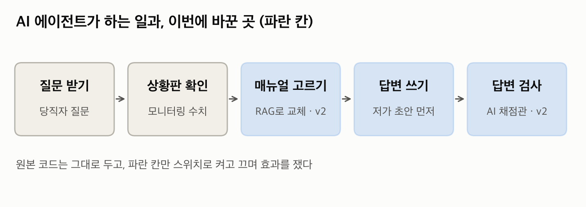
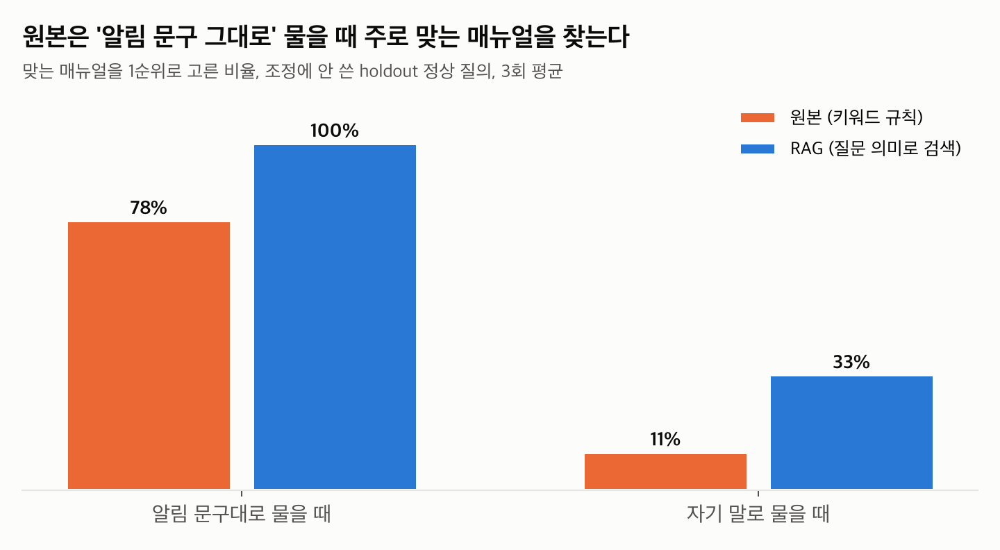
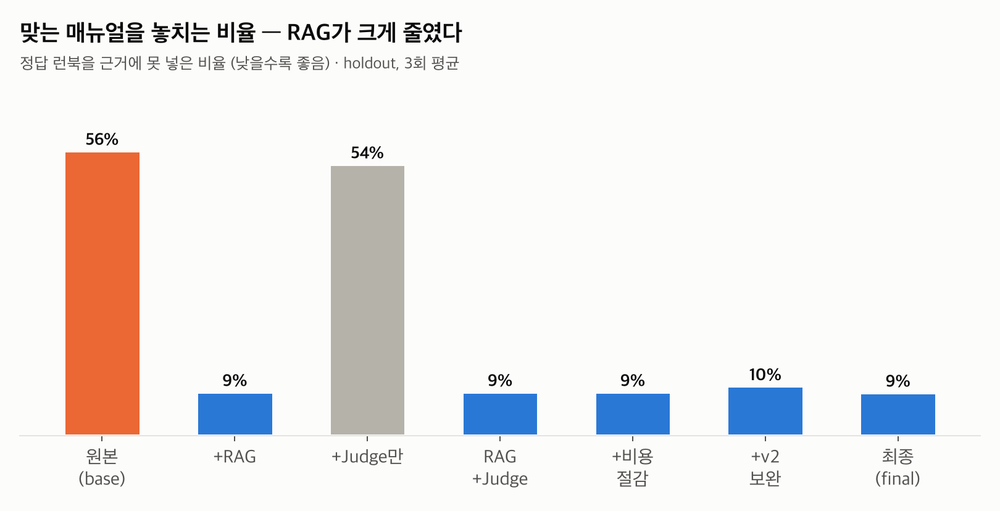
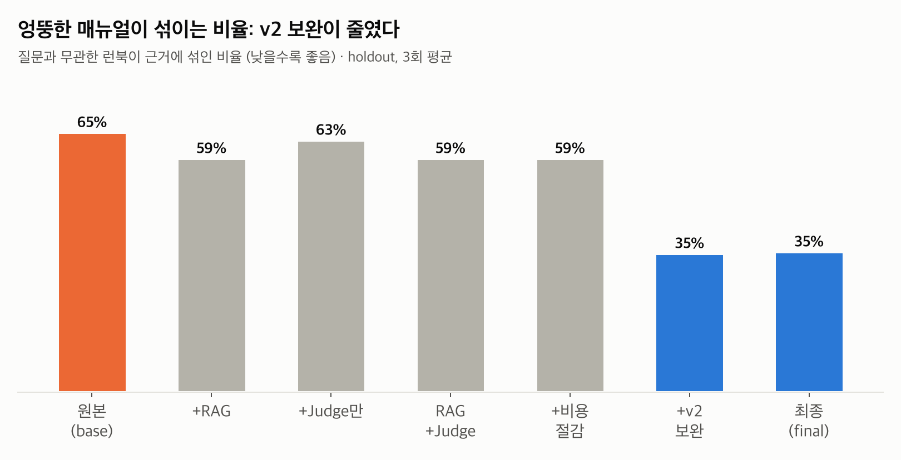
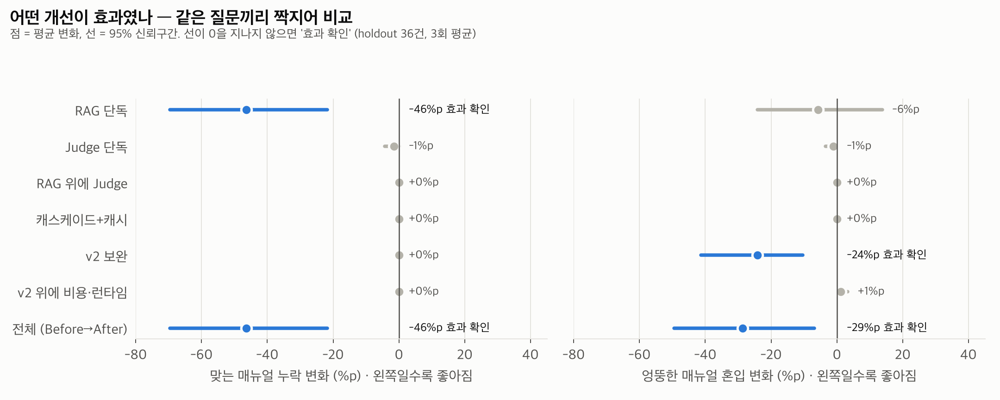
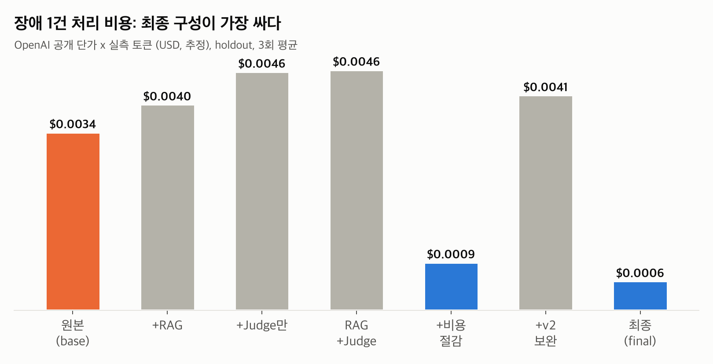
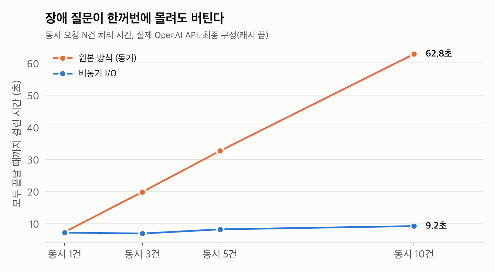
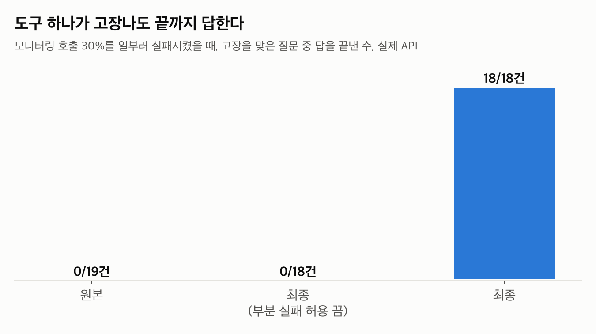
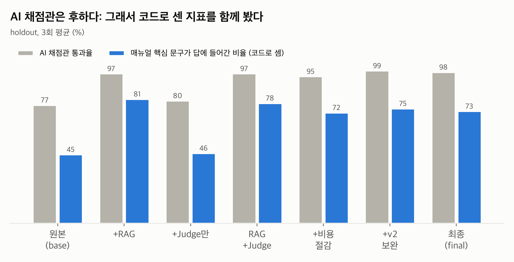

# incident-agent-ablation

SKALA 4기 AI Agent Mini-Project · 선택과제 1 (Base AI Agent 개선) · 광주 2반 장병헌 (G062)

> **한 문장 요약** — 장애 대응 AI 비서를 고친 뒤 "좋아졌다"고 말하는 대신, 개선을 하나씩 켜고 끄며 **무엇이 실제로 효과였는지 통계로 가려냈다.** 채점한 AI가 너무 후하게 주는지도 따로 쟀다.

| 맞는 매뉴얼 누락 | 엉뚱한 매뉴얼 혼입 | 장애 1건 비용 | 동시 질문 10개 | 도구 30% 고장 시 |
|:---:|:---:|:---:|:---:|:---:|
| **56% → 9%** | **65% → 35%** | **-84%** | **62.8초 → 9.2초** | **0/19 → 18/18 답변** |

<sub>원본 → 최종 구성. holdout 36문제 x 3회 평균 (동시성·고장은 실제 API 별도 벤치).</sub>

---

## 1. 이게 뭔가요? (비전공자용 3분 설명)

**상황** — 회사 서버에 장애가 나면 새벽에도 당직자가 대응해야 한다. 교수님이 준 **AI 비서(에이전트)** 는 당직자 질문을 받아 서버 상황판(모니터링)을 보고, 장애 유형별 **대처 매뉴얼(런북)** 을 골라 답을 써 준다.

**문제** — 이 비서는 질문을 읽지 않고 상황판의 경고 문구에 들어 있는 단어로 매뉴얼을 고른다. 그래서 "DB가 죽었다"고 물어도 "응답이 느릴 때" 매뉴얼을 가져오는 일이 잦았다.

**한 일** — 비서의 일부(파란 칸)를 고쳤다. 그리고 고친 것을 하나씩 켜고 끈 **7가지 버전**에 같은 시험 문제 60개를 3번씩 풀게 해서, 어떤 수정이 효과였는지 쟀다.



| 식당으로 치면 | 이 프로젝트에서 |
|---|---|
| 주방 | 회사 서버 |
| 주방 사고 (불, 냉장고 고장) | 장애 (DB 다운, CPU 과부하 등) |
| 새벽 당직 직원 | 당직 엔지니어 (이 비서를 쓰는 사람) |
| 옆에서 도와주는 AI 비서 | 에이전트 |
| 사고 유형별 대처 매뉴얼 6권 | 런북 6개 |
| 비서의 답안을 채점하는 AI 조교 | 평가 Judge (gpt-4o) |
| 조교가 제대로 채점하는지 보는 검수자 | 독립 평가자 (Claude), 사람 표본 채점 |

### 7가지 버전

| 버전 | 무엇을 켰나 |
|---|---|
| `base` | 교수님 원본 그대로 |
| `rag` | 매뉴얼을 질문 의미로 검색 (RAG) |
| `judge` | 비서 안에 AI 검수를 넣음 (떨어지면 다시 씀) |
| `rag_judge` | RAG + AI 검수 |
| `rag_judge_cost` | 위 + 싼 모델 먼저 쓰기(캐스케이드) + 반복 질문 캐시 |
| `rag_judge_v2` | RAG + AI 검수 + v2 보완 (1차 실험에서 찾은 약점 수정) |
| `final` | 전부 + 비동기 처리 + 도구 고장 견디기 |

---

## 2. 결과 — 그림으로

모든 수치는 **holdout 36문제**(개선 기준을 정할 때 한 번도 보지 않은 시험 문제)에서 **3번씩 반복**해 잰 평균이다.

### ① 맞는 매뉴얼을 찾게 됐다 — RAG의 효과

원본은 경고 문구 그대로 물을 때만 맞는 매뉴얼을 찾았다. 질문 의미로 검색하는 **RAG** 로 바꾸자 크게 나아졌다.




### ② 엉뚱한 매뉴얼이 덜 섞인다 — v2 보완의 효과

RAG는 비슷한 매뉴얼을 여러 개 넣다 보니 엉뚱한 것도 섞였다. 1차 실험에서 이 약점을 찾았고, "충분히 비슷하지 않으면 넣지 않는다"는 기준을 더한 **v2 보완** 으로 줄였다.



### ③ 무엇이 진짜 효과였나 — 짝지어 비교

같은 문제끼리 짝지어 "켰을 때 − 껐을 때"를 계산했다. 가로선(95% 신뢰구간)이 0을 지나지 않으면 우연이 아닌 **효과 확인**이다.



- **RAG** — 맞는 매뉴얼 누락을 46%p 줄였다 (효과 확인).
- **v2 보완** — 엉뚱한 매뉴얼 혼입을 24%p 줄였다 (효과 확인).
- **비서 안의 AI 검수(Judge)** — 품질이 나아졌다는 증거는 나오지 않았고, 시간(+1.8~2.3초)과 비용만 늘었다. "AI 검수를 넣으면 좋아진다"는 통념을 수치로 확인해 본 결과다.

### ④ 더 싸게, 더 튼튼하게



- **비용** — 1차 답안은 싼 모델로 쓰고, 검수에서 떨어질 때만 비싼 모델로 다시 쓰는 **캐스케이드** 가 핵심이다. 캐스케이드만 켜도 장애 1건 비용이 원본보다 73% 줄었고, v2 보완으로 다시 쓰는 횟수까지 줄어 최종 구성은 84% 줄었다 ($0.00343 → $0.00057).



- **동시 요청** — 원본 방식은 AI 호출이 한 줄로 줄을 서서, 질문 10개가 한꺼번에 오면 62.8초가 걸렸다. 비동기 처리로 바꾸자 9.2초 (실제 API, 약 6.9배).



- **도구 고장** — 상황판 조회의 30%를 일부러 실패시켰다. 원본은 고장을 맞은 질문에 하나도 답하지 못했고(0/19), 최종 구성은 모두 답했다(18/18). 실패한 조회는 답에 "조회 실패"로 표시된다.

### ⑤ 채점한 AI도 의심했다



AI 채점관(gpt-4o)은 대부분 구성에 90% 넘게 합격을 줬다. 너무 후하면 차이가 안 보이므로, **코드로 센 지표**(매뉴얼 핵심 문구가 답에 들어갔나, 맞는 매뉴얼을 넣었나)로 결론을 냈다.

다른 AI(Claude)가 채점 결과를 가린 채 원본 답 60개를 따로 채점해 비교했다. 일치율 70%, kappa 0.39였고, **AI 채점관은 Claude가 불합격으로 본 답 29개 중 17개(59%)를 합격시켰다** (`eval/claude_labels.yaml`). 이것은 AI끼리의 비교다. 사람 표본 20건 채점은 진행 중이다 ([라벨링 가이드](docs/라벨링_가이드.md)).

---

## 3. 결과 — 표 (자동 생성)

<!-- AUTO:holdout -->
| | base | +RAG | +Judge만 | RAG+Judge | +비용 | +v2 보완 | **final** |
|---|---|---|---|---|---|---|---|
| 정답 런북 누락률 ↓ | 56% | 9% | 54% | 9% | 9% | 10% | 9% |
| 무관 런북 혼입률 ↓ | 65% | 59% | 63% | 59% | 59% | 35% | 35% |
| 런북 핵심 어구 포함 (Judge 무관) | 45% | 81% | 46% | 78% | 72% | 75% | 73% |
| 평가 Judge 통과 (gpt-4o) | 77% | 97% | 80% | 97% | 95% | 99% | 98% |
| Recall@1 | 33% | 52% | 34% | 52% | 52% | 53% | 53% |
| 장애 1건당 비용 (USD) | 0.00343 | 0.00397 | 0.00460 | 0.00464 | 0.00093 | 0.00415 | 0.00057 |
| p95 지연 | 8.3초 | 8.9초 | 17.1초 | 12.0초 | 10.6초 | 11.8초 | 9.8초 |
<!-- /AUTO:holdout -->

출처: `results/{구성}_latest.json` (7구성 x 60문제 x 3회 = 1,260회, 실행 오류 0). 비용은 OpenAI 공개 단가 x 실측 토큰 추정치 (평가 Judge 제외). 지연 주의: 5개 구성은 7개 프로세스를 동시에 돌린 부하에서, `+비용`·`final` 은 캐시 버그 수정 뒤 2개 프로세스로 다시 쟀다. 그래서 이 두 구성과 나머지의 지연 차이에는 부하 차이가 섞여 있을 수 있다 (분리 측정은 안 함).

**개선별 기여도** — 같은 질문끼리 짝지은 bootstrap 95% 신뢰구간 (`results/stats_holdout.json`)

<!-- AUTO:contrib -->
| 켠 것 | 정답 누락 | 무관 혼입 | 어구 포함 | 질의당 비용 | 질의당 지연 |
|---|---|---|---|---|---|
| RAG 단독 | **-46%p [-70, -22]** ★ | -6%p [-24, +14] | **+37%p [+22, +55]** ★ | **+$0.0004** ★ | **+0.4초** ★ |
| Judge 단독 | -1%p [-4, +0] | -1%p [-3, +0] | +2%p [-2, +6] | **+$0.0009** ★ | **+2.3초** ★ |
| RAG 위에 Judge | +0%p [+0, +0] | +0%p [+0, +0] | -3%p [-7, +0] | **+$0.0005** ★ | **+1.8초** ★ |
| 캐스케이드+캐시 | +0%p [+0, +0] | +0%p [+0, +0] | -5%p [-19, +9] | **-$0.0030** ★ | **-0.7초** ★ |
| v2 보완 | +0%p [+0, +0] | **-24%p [-41, -10]** ★ | -3%p [-9, +2] | -$0.0003 | +0.1초 |
| v2 위에 비용·런타임 | +0%p [+0, +0] | +1%p [+0, +3] | -2%p [-10, +8] | **-$0.0030** ★ | **-0.9초** ★ |
| **전체 (Before→After)** | **-46%p [-70, -22]** ★ | **-29%p [-49, -7]** ★ | **+30%p [+12, +48]** ★ | **-$0.0024** ★ | **+1.4초** ★ |
<!-- /AUTO:contrib -->

굵은 글씨·★ = 95% 신뢰구간이 0을 포함하지 않음. 나머지는 차이가 있다고 말할 수 없다. 캐스케이드·v2 위 비용·전체 행의 **지연** 차이는 위의 부하 차이가 섞였을 수 있다 (같은 부하였던 1차 측정에서 캐스케이드 지연은 -0.1초 [-0.6, +0.3]로 유의하지 않았다). 표는 `scripts/gen_readme_tables.py` 가 results/ 에서 만든다.

---

## 4. 용어 사전

| 용어 | 쉬운 뜻 |
|---|---|
| 에이전트 | 질문을 받아 스스로 자료를 찾고 답을 쓰는 AI 프로그램 |
| 런북 (runbook) | 장애 유형별 대처 매뉴얼. 여기서는 6개 |
| 모니터링 | 서버 상태를 보여주는 상황판 (CPU 사용률, 경고 알림) |
| RAG | 질문과 뜻이 비슷한 문서를 찾아 답에 활용하는 방식 |
| LLM Judge (AI 채점관) | 다른 AI의 답을 채점하는 AI |
| 캐스케이드 | 싼 모델로 먼저 해 보고, 부족할 때만 비싼 모델을 쓰는 방식 |
| 비동기 | 한 작업이 끝나길 기다리지 않고 여러 작업을 동시에 진행하는 방식 |
| Ablation | 부품을 하나씩 빼거나 넣으면서 각 부품의 기여도를 재는 실험 |
| holdout | 기준을 정할 때 보지 않고 최종 시험에만 쓴 문제 (컨닝 방지) |
| 95% 신뢰구간 | "진짜 효과는 이 범위 안에 있을 것"이라는 범위. 0을 포함하면 효과를 장담할 수 없다 |
| kappa | 두 채점자가 우연 이상으로 얼마나 일치하는지 (1 = 완전 일치, 0 = 우연 수준) |
| %p (퍼센트포인트) | 비율끼리의 차이. 50%에서 30%로 줄면 20%p 감소 (40% 감소가 아님) |

---

## 5. 무엇을 바꿨나 (기술 상세)

원본 노드 함수는 그대로 두고, 노드 일부만 설정 스위치로 교체했다 (`src/ext/graph_ext.py`). `base` 구성은 원본 `build_graph`를 그대로 호출한다. 원본 `src/agent`는 이식 커밋(`55e15f1`) 이후 바뀌지 않았다.

| 스위치 | 교체 노드 | 원본 | 개선 |
|---|---|---|---|
| `runbook_selection: rag` | replan_check | 모니터링 알림 키워드 규칙, 런북 1개 | 질의 임베딩 순위 top 3, 1위 -0.05 이내 투입 |
| `validator: judge` | validate | 30자 이상 + "1)" 포함 | 4지표 LLM Judge, 3/4 통과, 재시도 2회 또는 120초 가드 |
| `cost.model_tiering` / `cost.cache` | write · route · plan | 항상 gpt-4o / 없음 | 1차 gpt-4o-mini, 반려 시에만 gpt-4o / 반복 질의 캐시 |
| `rag.min_score`, `rag.notices` (v2) | replan_check | 늘 런북 투입 | 최소 유사도 미만이면 '일치 런북 없음' 안내, 폴백 조회 사실 명시 |
| `judge.version: 2`, `judge.factcheck` (v2) | validate | - | 근거 밖 요구 금지, 고칠 수 없는 반려는 재작성 생략, 근거 없는 수치는 코드로 먼저 반려 |
| `runtime.async_io`, `runtime.tolerant_research` | route · plan · write · research | 동기 LLM 호출이 이벤트 루프를 막음, 도구 하나 실패 시 전체 실패 | 스레드로 분리, 실패한 태스크만 근거에 표시하고 나머지로 답함 |

처음 계획한 "역할별 모델 분리"는 base에 이미 있었다 (fast=gpt-4o-mini, quality=gpt-4o). 그래서 비용 축을 캐스케이드로 다시 정했다.

### 어떻게 쟀나

- **평가셋 60문제** (`eval/queries.yaml` v3): dev 24문제는 v2 기준값 조정에만 썼다. holdout 36문제는 v2 구현 전에 고정했고(커밋 `6eb9482`) 최종 보고에만 썼다.
- **반복과 유의성**: 7구성 x 3회, 반복 간 95% CI와 질문 단위 paired bootstrap(2,000회). 반복마다 캐시를 비워 모든 회차를 같은 조건(cold)으로 쟀다.
- **지표 축 분리**: 검색(맞는 매뉴얼 누락·엉뚱한 매뉴얼 혼입, Recall@k), 답변(AI 채점 4지표, 매뉴얼 핵심 문구 포함), 운영(건당 비용, 지연, 동시성, 장애 주입).
- **평가자 분리**: 평가 Judge는 gpt-4o로 고정해 파이프라인 Judge(gpt-4o-mini)와 분리했다. 독립 평가자(Claude) 블라인드 채점 60건으로 대조했다.
- **편향 검증**: 알림 문구대로 묻는 질문과 자기 말로 묻는 질문, dev와 holdout을 나눠 봤다.

## 6. 한계

- **일반화 격차**: RAG Recall@1이 dev 72%에서 holdout 52%로 떨어진다. 자기 말로 묻는 holdout 질문은 33%다.
- **엉뚱한 매뉴얼 혼입이 남는다** (최종 35%).
- **최소 유사도 기준은 경계값이다.** dev에서 맞는 매뉴얼이 있는 질문과 없는 질문의 점수 차이가 0.0023뿐이었다.
- **AI 채점관이 포화됐다.** 결론은 코드로 센 지표로 냈다. 사람 표본 채점은 진행 중이다.
- **속도와 품질의 맞교환**: 캐스케이드는 비용을 크게 줄이지만 매뉴얼 핵심 문구 포함이 조금 내려간다 (유의하지 않음). 최종 구성은 원본보다 질문당 약 1.4초 느리다 (RAG 검색과 검수 때문). 이 지연 차이에는 측정 부하 차이가 섞였을 수 있다.
- 라우터는 개선 범위 밖이다. holdout 36문제 x 3회라 1문제가 2.8%p다. 비용은 공개 단가 기준 추정치다. 마지막 실행 일부는 LangSmith 월 한도 초과로 추적 기록이 올라가지 않았다 (측정값과 무관).

## 7. 직접 돌려 보기

```bash
uv venv .venv --python 3.12
uv pip install --python .venv/bin/python -r requirements.txt
scripts/set_keys.sh                                 # 키 입력 (화면에 표시되지 않음, .env 는 커밋 안 됨)

.venv/bin/python -m pytest -q                       # 오프라인 테스트 (키 불필요)
scripts/run_all.sh                                  # 7구성 x 60문제 x 3회 + 캐시·동시성·장애 벤치 + 표
.venv/bin/python scripts/demo_side_by_side.py --id Q01   # 원본 vs 최종을 나란히 시연
.venv/bin/python scripts/make_figs.py               # 그림 다시 그리기
.venv/bin/python scripts/gen_readme_tables.py       # README 표 다시 만들기
.venv/bin/python scripts/label.py --only $(cat eval/human_sample_ids.txt)   # 사람 표본 채점
(cd deck && ../.venv/bin/python data.py > data.json && node build.js)       # 발표 덱 재생성
```

## 8. 폴더 구조

```
src/            교수님 베이스 원본 (변경 없음) + 개선
  agent/          원본 LangGraph 노드·LLM·MCP 클라이언트
  ext/            개선: graph_ext · rag · judge · factcheck · faults · meter
  adapter.py      평가 하네스 단일 진입점 run_once()
eval/           평가 하네스 (queries.yaml, configs/ 7개, run_ablation, report, stats, extra_metrics,
                agreement, calibrate_rag, cache_bench, concurrency_bench, fault_bench)
results/        실행 결과 json (보고서 수치의 출처). v1/ = 1차 실측
docs/           방법(05) · 결과 분석(06) · 결과표(04) · 라벨링 가이드 · figures/
deck/           발표 덱 생성기 (data.py → build.js) + pptx
tests/          오프라인 테스트 (fake 백엔드)
scripts/        원커맨드 실행 · 키 입력 · 라벨링 · 시연 · 그림 · README 표
```

자세한 분석: [docs/06_결과분석.md](docs/06_결과분석.md) · 방법: [docs/05_보고서_방법.md](docs/05_보고서_방법.md) · 전체 표: [docs/04_결과표.md](docs/04_결과표.md) · 발표: [deck/incident-agent-ablation.pptx](deck/incident-agent-ablation.pptx)
