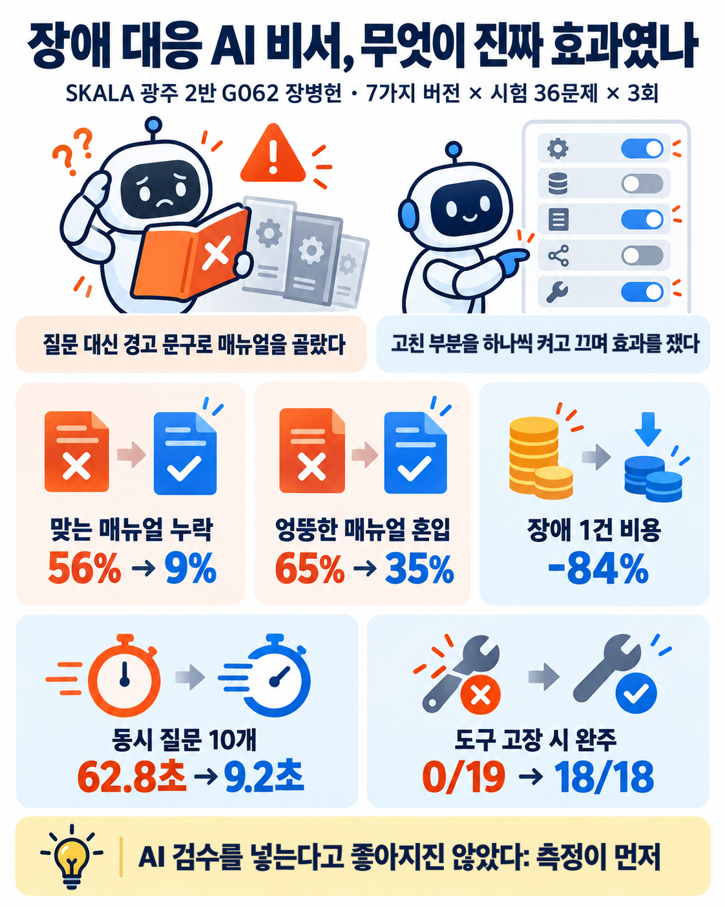
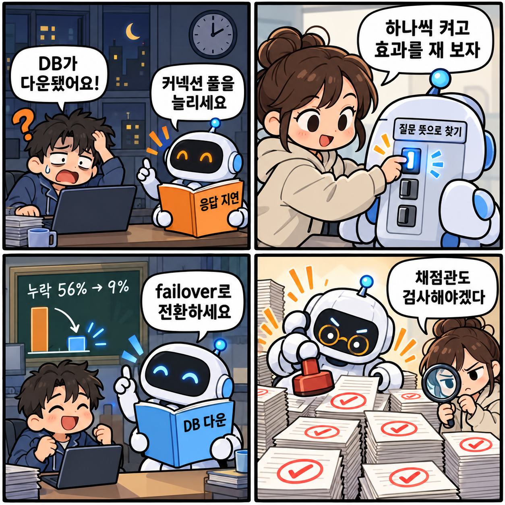
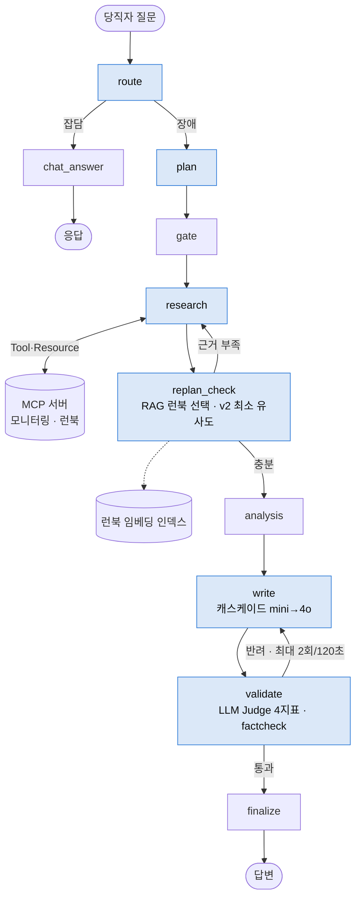
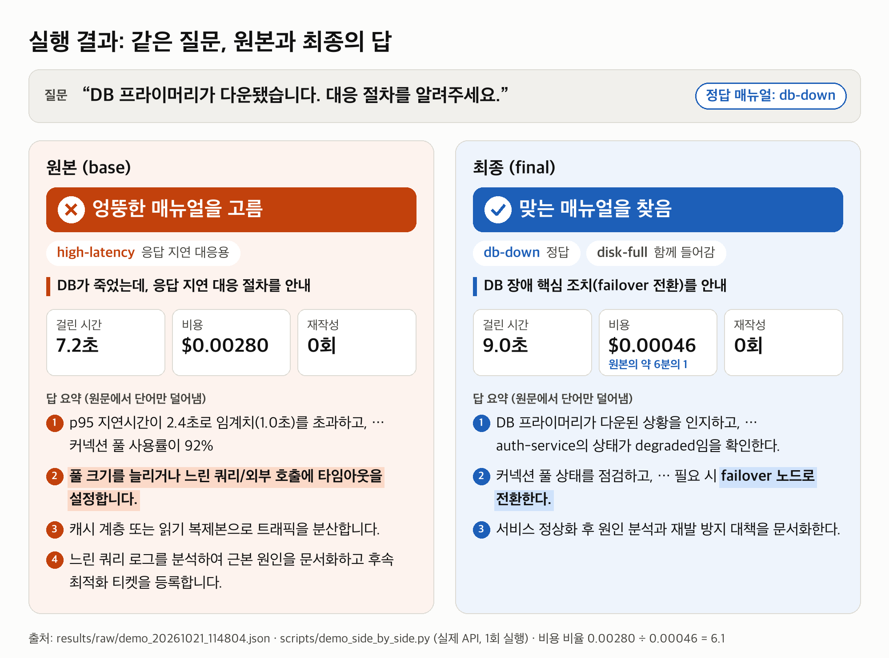

# 장애 대응 AI 에이전트 개선과 Ablation 검증

**SKALA 4기 광주 2반 · G062 · 장병헌**
AI Agent Mini-Project 선택과제 1 (Base AI Agent 개선) · 2026-10-22

> 장애 대응 AI 비서를 고친 뒤 "좋아졌다"고 말하는 대신, 개선을 하나씩 켜고 끄며 **무엇이 실제로 효과였는지 통계로 가려냈다.** 채점한 AI가 너무 후하게 주는지도 따로 쟀다.

| 맞는 매뉴얼 누락 | 엉뚱한 매뉴얼 혼입 | 장애 1건 비용 | 동시 질문 10개 | 도구 30% 고장 시 |
|:---:|:---:|:---:|:---:|:---:|
| **56% → 9%** | **65% → 35%** | **-84%** | **62.8초 → 9.2초** | **0/19 → 18/18 완주** |

<sub>원본 → 최종 구성. 앞의 셋은 holdout 36문제 x 3회 평균, 뒤의 둘은 실제 API 별도 벤치(1회 측정).</sub>

<p align="center"></p>

<sub>한 장 요약 그림은 ChatGPT로 그렸고, 그림 속 숫자는 모두 `results/` 실측값을 그대로 넣었다.</sub>

**목차** — [1. 문제와 구현](#1-문제-개선-및-신규-구현-사항) · [2. 기술 요소](#2-적용-기술-요소) · [3. 구현 결과](#3-구현-결과) · [4. 교훈](#4-교훈) · [부록](#부록)

---

## 1. 문제 개선 및 신규 구현 사항

### 1.1 이게 뭔가요 (비전공자용)

회사 서버에 장애가 나면 새벽에도 당직자가 대응해야 한다. 교수님이 준 **AI 비서(에이전트)** 는 당직자 질문을 받아 서버 상황판(모니터링)을 보고, 장애 유형별 **대처 매뉴얼(런북)** 6개 중 하나를 골라 답을 써 준다.

| 식당으로 치면 | 이 프로젝트에서 |
|---|---|
| 주방 사고 (불, 냉장고 고장) | 장애 (DB 다운, CPU 과부하 등) |
| 새벽 당직 직원 | 당직 엔지니어 (**이 비서를 쓰는 사람**) |
| 옆에서 도와주는 AI 비서 | 에이전트 |
| 사고 유형별 대처 매뉴얼 6권 | 런북 6개 |
| 비서의 답안을 채점하는 AI 조교 | 평가 Judge (gpt-4o) |
| 조교가 제대로 채점하는지 보는 검수자 | 독립 평가자 (Claude). 사람 표본 채점은 예정 |

<p align="center"></p>

<sub>4컷 요약 — ① 원본은 DB 다운 질문에 응답 지연 매뉴얼로 답한다 ② 고친 부분을 하나씩 켜고 효과를 잰다 ③ 질문 뜻으로 찾자 맞는 매뉴얼이 나온다 ④ 채점하는 AI도 검사한다. ChatGPT로 그림.</sub>


### 1.2 실태 현황 — 시장·연구·현업 도구 (2026-10-22 조사)

국외 서비스·국내 현황·논문·현업 MCP를 따로 조사하고 ChatGPT 웹 검색으로 교차 확인했다. 공식 문서·보도·논문 초록 기준으로 확인한 것만 적었고(논문 본문 수치까지 대조하지는 않음), 업체 수치는 **[업체 주장]** 으로 표시했다. 전체 표와 출처는 [docs/research/](docs/research/00_요약_실태현황.md)에 있다.

**① 장애는 비싸다.** 응답자 54%가 최근 중대 장애 비용이 10만 달러를 넘었다고 답했다. 같은 보고서에서 직원이 절차를 따르지 않아 생긴 장애도 늘었다 (Uptime Institute, *Annual Outage Analysis 2025*). 국내는 2022 카카오 장애 뒤 정부가 카카오에 장애 탐지·전파·복구 과정 재점검과 자동화 도입 등을 행정지도했고, 2025-07-08 시행 전자정부법 개정으로 행정 시스템을 1~4등급으로 관리한다.

**② 시장은 'AI SRE'로 움직이고 있다. 다만 제품마다 구조가 다르다.**

| 국외 정식 출시 (확인한 5개) | 근거로 쓰는 것 | MCP | 조치 방식 |
|---|---|---|---|
| PagerDuty SRE Agent (GA 2025-10-30) | 과거 인시던트·지식베이스 (런북 언급 없음) | MCP 서버 GA | 조치 단계 추천 |
| Datadog Bits AI SRE (GA 발표 2025-12-02) | 런북·텔레메트리 | MCP 서버 GA (에이전트 연결은 명시 없음) | 가설 검증 후 결론 전달 |
| Azure SRE Agent (GA 2026-03-11, Azure Updates 공지 기준) | 승인된 런북·skills, 모니터링, 과거 조사 | 커넥터로 연결 | 완화책 제안, 설정하면 실행 (Review/Autonomous 모드) |
| AWS DevOps Agent (GA 2026-03-31) | 런북을 담은 agent skills, 텔레메트리·코드·과거 인시던트 | 원격 MCP 연결 (문서) | 완화 계획 제공 |
| Grafana Assistant Investigations (2026-07) | 메트릭·로그·트레이스, rules·skills | 연결 가능 | 조사 보고서 작성 |

| 국내 사례 | 특징 |
|---|---|
| SK AX AXgenticWire NPO | 탐지·분석·영향도·조치 4개 에이전트, 모니터링 연동용 MCP 빌더. 대신증권 IT운영 7년 계약(2026-04 발표) |
| 삼성계정 Agentic AIOps | Datadog MCP 서버를 직접 만들고 과거 RCA를 벡터검색. 실행권은 사람이 가진다 |
| 롯데ON Tech Assistant | 알람이 울리면 매뉴얼 KB를 검색해 원인 후보와 조치를 Slack으로 보낸다 |
| 현대오토에버 ErrorWatcher | **LangGraph + runbooks 폴더 RAG**. 해커톤 PoC, 모의 모니터링 데이터 |
| GS리테일 AIOps Agent | Bedrock 자체 루프 + MCP 도구 7개 이상. RCA 문서 작성·상태 변경까지 자동. 인시던트 분석 30분 이상 → 약 2분 **[업체 공개 사례]** |

- 공통으로 보이는 것: 런북·과거 장애 같은 절차 지식을 근거로 쓰는 제품이 많고(Datadog·Azure·AWS·롯데ON·ErrorWatcher), 외부 도구는 MCP로 붙인다. 실행을 맡기는 정도는 제품마다 다르다(삼성계정은 사람이 실행, GS리테일은 자동, Azure는 모드 선택).
- 우리 에이전트는 조치를 **제안만** 하고 실행하지 않는다.

**③ 공개된 '효과 측정'은 드물다.** 공개 수치는 대부분 "최대 몇 %" 업체 주장이나 PoC, 장애 1건 사례다. 조사한 범위의 국내 기업·제품 공개 사례에서는 고정 평가셋이나 Ablation을 공개한 곳을 찾지 못했다(학계에는 통제 실험 연구가 있다, ④ 국내 연구). Datadog은 기능 하나(알림 서비스명을 초기 맥락에 넣기)가 무관한 신호를 끌어와 다른 조사를 **나쁘게 만든** 사례를 공개했다. 부품을 하나씩 켜고 끄며 재야 하는 이유다. 이 과제는 합성 평가셋 60문제와 AI 평가자라는 한계 안에서, 부품별 기여를 분리해 보였다.

**④ 연구와 비교하면**

| 우리 결과 | 같은 방향의 근거 | 주의할 점 |
|---|---|---|
| 런북 RAG로 누락 56% → 9% | Flow-of-Action(WWW'25 Industry): SOP 기반 멀티에이전트가 ReAct 대비 RCA 정확도 35.5% → 64.0% · Nissist(ECAI'24): 트러블슈팅 가이드 검색 | SOP만 뺀 비교는 아니다. 우리 원본은 키워드 규칙이라 수치 직접 비교는 안 된다 |
| 파이프라인 안 LLM Judge는 품질 향상 미확인 | Huang 외(ICLR'24): 추론 과제에서 외부 피드백 없는 자기교정은 효과가 없거나 해롭다 · Kamoi 외(TACL'24): 믿을 만한 외부 신호가 있을 때만 효과 | 우리 과제(보고서 재작성)와 과제가 다르다. Self-Refine(NeurIPS'23)은 약 20%p 개선을 보고했다 |
| 독립 평가자(Claude)가 불합격으로 본 답의 59%를 평가 Judge가 합격 | Thakur 외(2025): 판정기 관대함 편향, 퍼센트 일치율 대신 kappa 필요 | Zheng 외(NeurIPS'23)는 GPT-4 판정기의 사람 일치율 80% 이상을 보고했다. 우리 평가자는 사람이 아니다 |
| 캐스케이드로 비용 절감 | FrugalGPT(TMLR'24) 저가 → 고가 캐스케이드 · 현업 ServiceNow AIOps LEAP는 Small·Large 모델 트랙을 고르게 한다 | ServiceNow 문서에 승격 방식은 없다 |
| 국내 연구 | 오케스트로·한양대(ASPLOS'26 AIOps 워크숍, 보도 기준): RCA 에이전트 실패 1위는 데이터 해석 환각 71.2%, 구조 개선이 프롬프트 수정보다 효과 | 우리 해석(가설): LLM 자기 검수보다 코드 기반 사실 확인(factcheck)·도구 재조회가 다음 방향. factcheck 단독 효과는 따로 재지 않았다 |

**⑤ 현업에 붙인다면** — research·replan_check 노드는 Prometheus·Grafana·Datadog·Confluence·GitHub 공식 MCP를 **읽기 전용으로 설정해** 바꿔 끼우고(서버에 쓰기 도구도 있어 토큰·플래그로 막아야 한다), Slack·PagerDuty에 쓰는 write 노드에만 쓰기 권한과 **사람 승인**(LangGraph `interrupt`)을 붙인다 ([04_현업_MCP.md](docs/research/04_현업_MCP.md)). 연결 테스트는 하지 않았다.

### 1.3 기존 시스템의 문제점 및 해결 과제

| # | 문제 | 실제로 본 현상 |
|---|---|---|
| 1 | **매뉴얼을 질문이 아니라 경고 문구로 고른다** | "DB 프라이머리가 다운됐다"고 물어도 상황판 경고(`p95 latency`)를 보고 응답 지연 매뉴얼을 고른다. holdout에서 맞는 매뉴얼 누락 56% |
| 2 | **검수가 형식만 본다** | 원본 검수 규칙은 "30자 이상 + `1)` 포함". 엉뚱한 매뉴얼로 쓴 답도 통과한다 (base 60문제 x 3회 반려 0회) |
| 3 | **비용·동시성·장애 내성** | 답변은 늘 gpt-4o. 노드는 async여도 LLM 호출이 동기라 동시 요청이 줄을 선다. 도구 하나가 실패하면 질문 전체가 실패한다 |
| 4 | **개선 효과를 증명할 방법이 없다** | 여러 개선을 한꺼번에 붙이면 무엇이 효과였는지 모른다. AI 채점관이 후하면 점수도 믿기 어렵다 |

### 1.4 구현(개선)한 핵심 기능

원본 노드 함수는 그대로 두고, 같은 그래프에서 노드만 **설정 스위치로 교체**했다 (`src/ext/graph_ext.py`). `base` 구성은 원본 `build_graph`를 그대로 호출한다. 원본 `src/agent`는 이식 커밋(`55e15f1`) 이후 바뀌지 않았다.

| 해결할 문제 | 스위치 | 교체 노드 | 원본 → 개선 |
|---|---|---|---|
| 1 | `runbook_selection: rag` | replan_check | 경고 키워드 규칙, 런북 1개 → 질문 임베딩 순위 top 3, 1위와 0.05 이내만 투입 |
| 1 | `rag.min_score`, `rag.notices` (v2) | replan_check | 늘 투입 → 최소 유사도 미만이면 '일치 런북 없음' 안내, 폴백 조회 사실 명시 |
| 2 | `validator: judge` | validate | 형식 규칙 → 4지표 LLM Judge (3/4 통과), 재시도 2회 또는 120초 중 먼저 닿으면 종료 |
| 2 | `judge.version: 2`, `judge.factcheck` (v2) | validate | 근거 밖 요구 금지, 고칠 수 없는 반려는 재작성 생략, 근거에 없는 수치는 코드로 먼저 반려 |
| 3 | `cost.model_tiering`, `cost.cache` | write · route · plan | 늘 gpt-4o → 1차 gpt-4o-mini, 반려될 때만 gpt-4o (캐스케이드) + 반복 질의 캐시 |
| 3 | `runtime.async_io`, `runtime.tolerant_research` | route · plan · write · research | 동기 호출이 이벤트 루프를 막음 → 스레드로 분리 / 실패한 조회만 근거에 표시하고 나머지로 답함 |
| 4 | 평가 하네스 `eval/` | - | 7구성 Ablation, holdout 분리, 3회 반복, paired bootstrap, 평가자 대조 |

**7가지 구성** — 하나씩 켜서 각 개선의 기여도를 분리한다 (`eval/configs/*.yaml`).

| 구성 | 켠 것 |
|---|---|
| `base` | 교수님 원본 그대로 |
| `rag` | RAG 런북 선택 |
| `judge` | LLM Judge 검수만 |
| `rag_judge` | RAG + Judge |
| `rag_judge_cost` | 위 + 캐스케이드 + 캐시 |
| `rag_judge_v2` | RAG + Judge + v2 보완 (1차 실험에서 찾은 약점 수정) |
| `final` | 전부 + 비동기 I/O + 도구 부분 실패 허용 |

---

## 2. 적용 기술 요소

| 범주 | 원본에 있던 것 | 이번에 추가·검증한 것 | 위치 |
|---|---|---|---|
| **Multi-Agent & LangGraph** | Supervisor(route·plan)가 조사 태스크를 나눠 서브 조사(research)에 맡김. 전담 analysis 노드 + gate, 상한형 동적 재계획(replan_check → research), 전담 validator | 같은 그래프 구조에서 노드 6개를 설정으로 교체하는 `build_graph_ext`. 재계획 판단(replan_check)에 RAG를 넣음 | `src/agent/graph.py`, `src/ext/graph_ext.py` |
| **MCP** | 운영 서버: Tool `get_monitoring_status`, Resource `runbook://incident-response/{type}`, Prompt `incident_analysis_prompt`. 문서 서버: Resource `docs://api-reference/{section}`. stdio 클라이언트 | RAG가 고른 런북 본문도 MCP Resource로 읽음. 도구 일부 실패를 견디는 research 노드, 실패를 일부러 넣는 `FaultyMCP` 래퍼 | `src/mcp_server.py`, `src/agent/mcp_client.py`, `src/ext/faults.py` |
| **RAG** | 없음 (키워드 규칙) | `text-embedding-3-small` 임베딩, 코사인 순위 top 3 + margin 0.05, 최소 유사도 0.3236 (dev에서만 보정). 런북이 6개라 별도 Vector DB 대신 디스크 캐시 + 메모리 인덱스로 구현 | `src/ext/rag.py`, `eval/calibrate_rag.py` |
| **아키텍처·코드 품질** | `SupervisorDeps` 명시적 의존성 주입 | `ExtDeps(SupervisorDeps)`로 확장, 7구성 YAML, 단일 진입점 `run_once()`, 오프라인 테스트 25개 (fake LLM 백엔드, 캐시 누수 회귀 테스트 포함) | `src/ext/`, `src/adapter.py`, `tests/` |
| **관측 가능성 & 평가** | LangSmith `@traceable` | 1,260회 실행 행마다 LangSmith run ID 기록. 파이프라인 Judge(gpt-4o-mini)와 **평가 Judge(gpt-4o)를 분리**, Judge와 무관한 코드 지표 병행, 독립 평가자(Claude) 블라인드 60건으로 평가 Judge 관대함 측정 | `src/adapter.py`, `eval/judge.py`, `eval/agreement.py` |
| **기타** | - | 비용·토큰 계측(Retry-After 재시도), 근거 없는 수치 검사(factcheck), paired bootstrap 95% CI, holdout 사전 고정(커밋 `6eb9482`), 원커맨드 재실행 `scripts/run_all.sh` | `src/ext/meter.py`, `src/ext/factcheck.py`, `eval/stats.py` |

---

## 3. 구현 결과

### 3.1 아키텍처 흐름도 — 파란 노드가 교체한 곳



<sub>route·plan·write는 비동기 I/O(스레드 분리), research는 도구 부분 실패 허용으로 교체. 각 교체는 설정 스위치로 켜고 끈다.</sub>

**정상 동작 근거**
- 7구성 x 60문제 x 3회 = **1,260회 실제 API 실행, 실행 오류 0** (`results/*_latest.json`)
- 오프라인 테스트 **25개 통과** (`.venv/bin/python -m pytest -q`, 키 불필요)
- 원본 동작 보존: `base` 구성은 원본 `build_graph`를 그대로 호출 (`src/adapter.py`)

### 3.2 주요 기능 시연 시나리오와 실행 결과 화면

| # | 시나리오 | 확인하는 기능 | 재현 명령 | 결과 (실제 API) |
|---|---|---|---|---|
| 1 | 당직자가 "DB 프라이머리가 다운됐습니다"라고 묻는다 | RAG 런북 선택 | `.venv/bin/python scripts/demo_side_by_side.py --id Q01` | 원본 응답 지연 매뉴얼 → 최종 DB 다운 매뉴얼 (아래 화면) |
| 2 | 질문 10개가 동시에 들어온다 | 비동기 I/O | `.venv/bin/python -m eval.concurrency_bench` | 62.8초 → 9.2초 |
| 3 | 모니터링 조회의 30%가 실패한다 | 도구 부분 실패 허용 | `.venv/bin/python -m eval.fault_bench` | 고장 맞은 질문 완주 0/19 → 18/18 |
| 4 | 같은 질문이 반복된다 | 반복 질의 캐시 | `.venv/bin/python -m eval.cache_bench --config eval/configs/final.yaml` | 2회차 캐시 적중 112/160, 지연 p50 7.9초 → 5.6초 |
| 5 | 7구성 전체를 다시 잰다 | Ablation 하네스 | `scripts/run_all.sh` | 1,260회, 실행 오류 0 |

**시나리오 1 실행 화면 — 같은 질문, 원본과 최종**



원본은 경고 문구를 보고 응답 지연 매뉴얼을 골라 커넥션 풀 늘리기를 권한다. 최종은 DB 다운 매뉴얼을 골라 failover 전환을 권한다 (디스크 부족 매뉴얼도 함께 들어가 혼입은 남았다). 재현: `.venv/bin/python scripts/demo_side_by_side.py --id Q01`

### 3.3 결과 — 그림으로

모든 수치는 **holdout 36문제**(개선 기준을 정할 때 한 번도 보지 않은 시험 문제)에서 **3번씩 반복**해 잰 평균이다.

**① 원본은 경고 문구 그대로 물을 때 주로 맞는 매뉴얼을 찾았다 → RAG로 누락 56% → 9%**


**② RAG는 엉뚱한 매뉴얼도 섞었다 → v2 보완("충분히 비슷하지 않으면 넣지 않는다")으로 59% → 35%**


**③ 무엇이 진짜 효과였나** — 같은 문제끼리 짝지어 "켰을 때 − 껐을 때"를 계산했다. 가로선(95% 신뢰구간)이 0을 지나지 않으면 우연이 아닌 효과다.


- **RAG** — 맞는 매뉴얼 누락 -46%p (유의)
- **v2 보완** — 엉뚱한 매뉴얼 혼입 -24%p (유의)
- **비서 안의 LLM Judge** — 품질 향상은 확인되지 않았고, 시간(질의당 +1.8~2.7초)과 비용만 늘었다

**④ 더 싸게** — 캐스케이드가 핵심이다. 캐스케이드만 켠 구성에서 장애 1건 비용이 원본보다 73% 줄었다. 캐스케이드에 v2 보완·런타임 개선을 더해 재작성이 사라진 최종 구성에서는 84% 줄었다 ($0.00343 → $0.00057). 장애 1건 비용 = 반복마다 전체 질의 비용 ÷ 장애로 처리된 질의 수.


**⑤ 더 튼튼하게** — 실제 API로 쟀다 (동시 질문 수마다 1회 측정, 신뢰구간 없음).
- 동시 질문 10개: 62.8초 → 9.2초 (약 6.9배)
- 상황판 조회의 30%를 일부러 실패시키자, 원본은 고장 맞은 질문을 하나도 끝까지 처리하지 못했고(0/19), 최종은 모두 끝까지 처리했다(18/18). 완주 여부만 쟀고 그 답의 품질은 따로 평가하지 않았다.


**⑥ 채점한 AI도 의심했다** — 평가 Judge(gpt-4o)는 대부분 구성에 90% 넘게 합격을 줬다. 그래서 결론은 **코드로 센 지표**(맞는 매뉴얼을 넣었나, 매뉴얼 핵심 문구가 답에 들어갔나)로 냈다. 독립 평가자 Claude가 판정을 가린 채 원본 답 60개를 채점해 대조하니 일치율 70%, kappa 0.39였고, **평가 Judge는 Claude가 불합격으로 본 29개 중 17개(59%)를 합격시켰다** (`eval/claude_labels.yaml`). AI끼리의 비교이며, 사람 표본 채점은 아직 하지 않았다 (`scripts/label.py` 준비됨).


### 3.4 결과 — 표 (자동 생성)

<!-- AUTO:holdout -->
| | base | +RAG | +Judge만 | RAG+Judge | +비용 | +v2 보완 | **final** |
|---|---|---|---|---|---|---|---|
| 정답 런북 누락률 ↓ | 56% | 9% | 54% | 9% | 9% | 10% | 9% |
| 무관 런북 혼입률 ↓ | 65% | 59% | 63% | 59% | 59% | 35% | 35% |
| 런북 핵심 어구 포함 (Judge 무관) | 45% | 81% | 46% | 78% | 72% | 75% | 73% |
| 평가 Judge 통과 (gpt-4o) | 77% | 97% | 80% | 97% | 95% | 99% | 98% |
| Recall@1 | 33% | 52% | 34% | 52% | 52% | 53% | 53% |
| 장애 1건당 비용 (USD) | 0.00343 | 0.00397 | 0.00460 | 0.00464 | 0.00093 | 0.00415 | 0.00057 |
| p95 지연 (같은 부하 재측정) | 8.6초 | 9.2초 | 16.1초 | 12.3초 | 12.2초 | 12.1초 | 12.1초 |
<!-- /AUTO:holdout -->

출처: `results/{구성}_latest.json` (7구성 x 60문제 x 3회 = 1,260회, 실행 오류 0). 비용은 OpenAI 공개 단가 x 실측 토큰 추정치 (평가 Judge 제외). **지연은 같은 부하로 다시 쟀다.** 처음 측정에서는 `+비용`·`final` 만 캐시 버그 수정 뒤 더 가벼운 부하에서 다시 재서 지연 비교에 부하 차이가 섞였다. 그래서 7구성을 같은 조건(동시 7프로세스 x workers 2, holdout 36문제 x 3회, 평가 Judge 생략)으로 다시 재서 p95 지연과 기여도 표의 지연 열을 그 값으로 바꿨다 (`scripts/run_latency_ctrl.sh`, `results/*_latctl_latest.json`, 실행 오류 0, 추가 비용 약 $2). 같은 재측정에서 품질도 같은 방향이었다(RAG 누락 -38%p, v2 혼입 -24%p, 둘 다 유의).

**개선별 기여도** — 같은 질문끼리 짝지은 bootstrap 95% 신뢰구간 (`results/stats_holdout.json`)

<!-- AUTO:contrib -->
| 켠 것 | 정답 누락 | 무관 혼입 | 어구 포함 | 질의당 비용 | 질의당 지연 (같은 부하 재측정) |
|---|---|---|---|---|---|
| RAG 단독 | **-46%p [-70, -22]** ★ | -6%p [-24, +14] | **+37%p [+22, +55]** ★ | **+$0.0004** ★ | **+0.4초** ★ |
| Judge 단독 | -1%p [-4, +0] | -1%p [-3, +0] | +2%p [-2, +6] | **+$0.0009** ★ | **+2.7초** ★ |
| RAG 위에 Judge | +0%p [+0, +0] | +0%p [+0, +0] | -3%p [-7, +0] | **+$0.0005** ★ | **+1.8초** ★ |
| 캐스케이드+캐시 | +0%p [+0, +0] | +0%p [+0, +0] | -5%p [-19, +9] | **-$0.0030** ★ | +0.1초 |
| v2 보완 | +0%p [+0, +0] | **-24%p [-41, -10]** ★ | -3%p [-9, +2] | -$0.0003 | +0.0초 |
| v2 위에 비용·런타임 | +0%p [+0, +0] | +1%p [+0, +3] | -2%p [-10, +8] | **-$0.0030** ★ | **+0.3초** ★ |
| **전체 (Before→After)** | **-46%p [-70, -22]** ★ | **-29%p [-49, -7]** ★ | **+30%p [+12, +48]** ★ | **-$0.0024** ★ | **+2.5초** ★ |
<!-- /AUTO:contrib -->

굵은 글씨·★ = 95% 신뢰구간이 0을 포함하지 않음. 나머지는 차이가 있다고 말할 수 없다. 품질·비용 열은 원 측정(평가 Judge 포함), 지연 열은 같은 부하 재측정 값이다. 처음 측정에서 보였던 캐스케이드 -0.7초, v2 위 비용·런타임 -0.9초는 부하 차이 때문이었고, 같은 부하에서는 각각 +0.1초(유의하지 않음), +0.3초였다. 표는 `scripts/gen_readme_tables.py` 가 results/ 에서 만든다.

---

## 4. 교훈

### 4.1 한계와 트레이드오프

| 항목 | 내용 |
|---|---|
| 일반화 격차 | RAG Recall@1이 dev 72% → holdout 52%. 자기 말로 묻는 holdout 질문은 33% |
| 엉뚱한 매뉴얼 혼입 | 최종 35%가 남는다. 1위와 점수가 가까운 런북을 함께 넣는 규칙, 맞는 런북이 없는 질문에도 런북이 들어가는 경우가 원인 |
| 최소 유사도 기준 | 경계값이다. dev에서 맞는 매뉴얼이 있는 질문과 없는 질문의 점수 차이가 0.0023뿐 |
| 비용 ↔ 품질 | 캐스케이드는 비용을 크게 줄이지만 매뉴얼 핵심 문구 포함이 -5%p (유의하지 않음) |
| 품질 ↔ 속도 | LLM Judge는 질의당 +1.8~2.7초. 최종은 원본보다 질의당 +2.5초, p95 8.6초 → 12.1초 (같은 부하 재측정). 캐스케이드는 비용만 줄이고 지연은 줄이지 않았다 |
| 평가의 한계 | 평가 Judge 포화 → 코드 지표로 결론. 독립 평가자는 AI(Claude)이고 사람 표본 채점은 아직 없다. holdout 36문제 x 3회라 1문제 = 2.8%p. 비용은 공개 단가 추정치. 동시성·장애 주입은 1회 측정 |
| 범위 밖 | 라우터는 개선하지 않았다. 마지막 실행 일부는 LangSmith 월 한도 초과로 추적이 올라가지 않았다 (측정값은 로컬 기록이라 무관) |

### 4.2 향후 개선

1. **증상 예시 문장 색인** — 런북 본문 외에 "이런 증상이면 이 런북" 예시를 색인해 질문과 문서의 표현 차이를 줄인다 (일반화 격차 대응).
2. **재순위(reranker)와 투입 개수 조절** — 질문 속 증상 수에 맞춰 넣는 런북 수를 정해 혼입을 줄인다.
3. **캐스케이드 승급 기준을 코드 지표로** — LLM Judge 대신 결정적 어구 대조로 비싼 모델 승급 여부를 정한다.
4. **현업 MCP 연결** — 모니터링·런북을 읽기 전용으로 설정한 공식 MCP(Prometheus·Grafana·Confluence 등)로 바꾸고, 쓰기 도구는 사람 승인 뒤에만 실행한다 ([docs/research/04_현업_MCP.md](docs/research/04_현업_MCP.md)).
5. **평가 확대** — 질의 수를 늘리고, 사람 라벨로 평가 Judge를 보정하고, 라우터 개선도 같은 Ablation 체계로 재측정한다.

### 4.3 수행 소감 및 느낀점

- **"넣으면 좋아진다"는 직관을 측정으로 확인해야 했다.** LLM Judge 검수를 붙이면 품질이 오를 거라 생각했지만, 같은 문제끼리 짝지어 보니 품질 향상은 보이지 않고 시간과 비용만 늘었다. 개선을 하나씩 켜고 끄는 Ablation이 없었다면 RAG의 효과를 Judge의 효과로 착각했을 것이다.
- **채점하는 AI도 검증 대상이다.** 평가 Judge가 거의 모든 답에 합격을 주는 것을 보고, 코드로 셀 수 있는 지표와 독립 평가자를 함께 두었다. 점수 하나보다 서로 다른 잣대 여러 개가 결론을 지탱한다.
- **측정 인프라의 버그가 결론을 바꿀 뻔했다.** 반복 측정 사이에 캐시가 남아 2회차 지연과 비용이 좋게 나왔다. 회귀 테스트로 원인을 고정하고 cold 3회로 다시 잰 뒤에야 숫자를 믿을 수 있었다. 지연도 마찬가지였다. 일부 구성만 다른 부하에서 재서 "캐스케이드가 지연도 줄였다"고 보였지만, 7구성을 같은 부하로 다시 재자 그 효과는 사라졌다. 측정 조건을 맞추는 일이 개선만큼 중요했다.

---

## 부록

### 용어 사전

| 용어 | 쉬운 뜻 |
|---|---|
| 에이전트 | 질문을 받아 스스로 자료를 찾고 답을 쓰는 AI 프로그램 |
| 런북 (runbook) | 장애 유형별 대처 매뉴얼. 여기서는 6개 |
| RAG | 질문과 뜻이 비슷한 문서를 찾아 답에 활용하는 방식 |
| LLM Judge | 다른 AI의 답을 채점하는 AI |
| 캐스케이드 | 싼 모델로 먼저 해 보고, 부족할 때만 비싼 모델을 쓰는 방식 |
| 비동기 | 한 작업이 끝나길 기다리지 않고 여러 작업을 동시에 진행하는 방식 |
| Ablation | 부품을 하나씩 빼거나 넣으면서 각 부품의 기여도를 재는 실험 |
| holdout | 기준을 정할 때 보지 않고 최종 시험에만 쓴 문제 (컨닝 방지) |
| 95% 신뢰구간 | "진짜 효과는 이 범위 안에 있을 것"이라는 범위. 0을 포함하면 효과를 장담할 수 없다 |
| kappa | 두 채점자가 우연 이상으로 얼마나 일치하는지 (1 = 완전 일치, 0 = 우연 수준) |
| %p (퍼센트포인트) | 비율끼리의 차이. 50%에서 30%로 줄면 20%p 감소 (40% 감소가 아님) |

### 측정 방법

- **평가셋 60문제** (`eval/queries.yaml` v3): dev 24문제는 v2 기준값 조정에만 썼다. holdout 36문제는 v2 구현 전에 고정했고(커밋 `6eb9482`) 최종 보고에만 썼다. 카테고리: 일반·제약·복합·미등록 시스템·모호.
- **반복과 유의성**: 7구성 x 3회, 반복 간 95% CI와 질문 단위 paired bootstrap(2,000회). 반복마다 캐시를 비워 모든 회차를 같은 조건(cold)으로 쟀다.
- **지표 축 분리**: 검색(맞는 매뉴얼 누락·엉뚱한 매뉴얼 혼입, Recall@k), 답변(평가 Judge 4지표, 매뉴얼 핵심 문구 포함), 운영(건당 비용, 지연, 동시성, 장애 주입).
- **편향 검증**: 알림 문구대로 묻는 질문과 자기 말로 묻는 질문, dev와 holdout을 나눠 봤다.
- 자세한 분석: [docs/06_결과분석.md](docs/06_결과분석.md) · 방법: [docs/05_보고서_방법.md](docs/05_보고서_방법.md) · 전체 표: [docs/04_결과표.md](docs/04_결과표.md) · 발표: [5분용 8장](deck/incident-agent-ablation_5min.pptx) · [Canva판](https://www.canva.com/d/xUF8JQy7dweWq_R) · [전체 18장](deck/incident-agent-ablation.pptx) · [발표 대본](docs/발표_대본.md) · 조사 근거: [docs/research/](docs/research/00_요약_실태현황.md)

### 직접 돌려 보기

```bash
uv venv .venv --python 3.12
uv pip install --python .venv/bin/python -r requirements.txt
scripts/set_keys.sh                                 # 키 입력 (화면에 표시되지 않음, .env 는 커밋 안 됨)

.venv/bin/python -m pytest -q                       # 오프라인 테스트 (키 불필요)
scripts/run_all.sh                                  # 7구성 x 60문제 x 3회 + 캐시·동시성·장애 벤치 + 표
.venv/bin/python scripts/demo_side_by_side.py --id Q01   # 원본 vs 최종을 나란히 시연
.venv/bin/python scripts/make_figs.py               # 그림 다시 그리기
.venv/bin/python scripts/gen_readme_tables.py       # README 표 다시 만들기
.venv/bin/python scripts/label.py --only $(cat eval/human_sample_ids.txt)   # 사람 표본 채점
(cd deck && ../.venv/bin/python data.py > data.json && node build.js)       # 발표 덱 재생성
```

### 폴더 구조

```
src/            교수님 베이스 원본 (변경 없음) + 개선
  agent/          원본 LangGraph 노드·LLM·MCP 클라이언트
  ext/            개선: graph_ext · rag · judge · factcheck · faults · meter
  adapter.py      평가 하네스 단일 진입점 run_once()
eval/           평가 하네스 (queries.yaml, configs/ 7개, run_ablation, report, stats, extra_metrics,
                agreement, calibrate_rag, cache_bench, concurrency_bench, fault_bench)
results/        실행 결과 json (보고서 수치의 출처). v1/ = 1차 실측
docs/           방법(05) · 결과 분석(06) · 결과표(04) · 라벨링 가이드 · figures/
deck/           발표 덱 생성기 (data.py → build.js) + pptx
tests/          오프라인 테스트 (fake 백엔드)
scripts/        원커맨드 실행 · 키 입력 · 라벨링 · 시연 · 그림 · README 표
```
