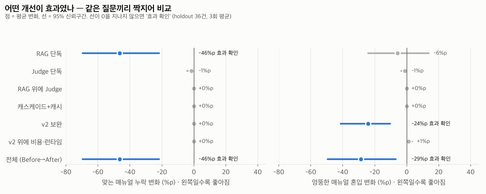
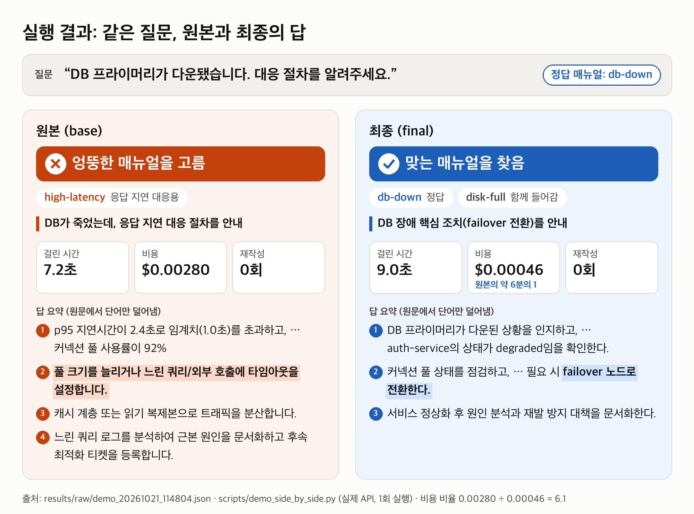
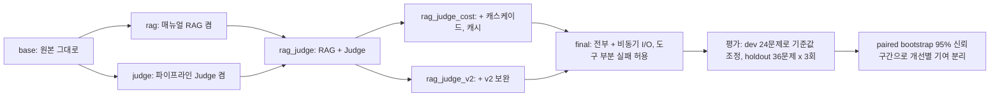

# 장애 대응 AI 에이전트 개선과 Ablation 검증

[](https://github.com/jang961111-hash/incident-agent-ablation/actions/workflows/ci.yml)

> **English:** I added RAG, a judge, and cost optimizations to an instructor-provided incident-response agent as config switches, ran seven on/off configurations, and used paired bootstrap confidence intervals to show which change actually worked (missed required runbooks 56% to 9% on holdout questions that have a matching runbook).

SKALA 4기 AI Agent Mini-Project 선택과제 1(Base AI Agent 개선), 개인 과제, 2026.10.20 - 2026.10.22. 원본 에이전트(LangGraph, MCP)는 강사 제공 코드이고, 원본 노드는 그대로 두고 설정 스위치로 교체했습니다.

개선을 한꺼번에 붙인 뒤 "좋아졌다"고 말하는 대신, 개선을 하나씩 켜고 끄며 무엇이 실제로 효과였는지 통계로 가렸습니다. 채점하는 AI가 너무 후하게 주는지도 따로 쟀습니다.

**한 줄 실행** (API 키 없이, 비용 0): `make reproduce-offline` (먼저 [실행과 재현](#실행과-재현)의 설치 3줄)

**링크**: [포트폴리오 상세 페이지](https://jang961111-hash.github.io/projects/incident-agent-ablation/) | [수치 근거 CLAIMS.md](CLAIMS.md) | [자세한 설명 docs/DETAILS.md](docs/DETAILS.md) | [코드 가이드](docs/08_코드_가이드.md) | [회고](docs/07_회고.md)

## 핵심 결과

원본 에이전트와 개선한 최종 구성(`final`)의 비교입니다. 1~3행은 개발 중 한 번도 보지 않은 시험 문제(holdout) 36개를 3번씩 푼 평균입니다. 4~5행은 실제 OpenAI API로 따로 돌린 시험입니다.

| 무엇을 쟀나 | 원본 | 개선 후 | 한계 |
|---|:---:|:---:|---|
| 꼭 봐야 할 매뉴얼(런북)을 답에서 빠뜨린 비율 | 56% | **9%** | 분모는 정답 매뉴얼이 있는 질문. 직접 만든 합성 질문 기준이며, 다른 AI가 쓴 외부 문항 15개에서는 최종 누락이 58% |
| 상관없는 매뉴얼을 끌어온 비율 | 65% | **35%** | 최종에도 35%가 남음 |
| 장애 1건 API 요금 | $0.00343 | **$0.00057** (-84%) | OpenAI 공개 단가 기준 추정치, 평가 Judge 비용 제외 |
| 질문 10개 동시 처리 시간 | 62.8초 | **9.2초** | 모의 모니터링 환경. 5회 반복에서 6.5~9.4배로 방향 동일 |
| 상황판 조회 30% 고장 주입 시 끝까지 답한 질문 | 0/19 | **18/18** | 끝까지 답했는지만 봄, 답의 품질은 재지 않음. 분모는 고장이 실제로 걸린 질문 수이며 실행마다 달라서(원본 19개, 최종 18개) 두 값의 분모가 다름(`CLAIMS.md`의 fault 행) |

- 대가: 최종 구성은 원본보다 질의당 +2.5초 느립니다(p95 8.6초 에서 12.1초).
- 파이프라인 Judge(답을 내보내기 전 AI 검사)는 품질 향상이 확인되지 않아 그대로 보고했습니다.
- 평가 Judge(gpt-4o)는 독립 평가자(Claude)가 불합격으로 본 답 29개 중 17개(59%)를 합격시켜, 결론은 코드로 센 지표로 냈습니다. 사람 표본 채점은 아직 하지 않았습니다.
- 운영 환경 적용이 아니라 모의 모니터링 데이터와 직접 만든 합성 질문 60개 기준입니다.



개선별 기여도입니다. 막대가 0에 닿지 않는 것만 효과가 확인된 것입니다(RAG 단독으로 누락 -46%p, v2 보완으로 혼입 -24%p).



"DB 프라이머리가 다운됐습니다" 질문에서 원본은 응답 지연 매뉴얼을, 최종은 DB 다운 매뉴얼을 골랐습니다(실제 API 1회 실행 기록).

## 실험 설계

개선마다 설정 스위치(`eval/configs/*.yaml`)를 두고 7개 구성을 만들어, 같은 질문끼리 켰을 때와 껐을 때를 짝지어 비교했습니다. 7구성 x 60문제 x 3회, 실제 API 1,260회 실행에서 실행 오류는 0이었습니다.



- holdout 36문제는 v2 구현 전에 커밋으로 고정했고(`6eb9482`), 기준값은 dev 24문제에서만 조정했습니다.
- 채점 AI를 둘로 나눴습니다. 에이전트 안의 파이프라인 Judge(gpt-4o-mini)와 에이전트 밖의 평가 Judge(gpt-4o)를 분리하고, 코드로 센 지표를 함께 봤습니다.

## 내 역할

개인 과제입니다. 평가 설계, 실험 실행, 결과 분석, 보고서와 발표를 맡았습니다. 원본 에이전트는 강사가 제공한 코드이고, 문서의 수치는 결과 파일과 자동 대조합니다(`scripts/check_claims.py`).

## 실행과 재현

Python 3.12 기준이며 `uv`가 필요합니다(`uv`가 없으면 `python3.12 -m venv .venv && .venv/bin/pip install -r requirements.txt`로 대신할 수 있지만, 이 대체 명령은 실행해 확인하지 않았습니다). 아래 명령은 모두 저장소의 `Makefile`, `scripts/`, `requirements.txt`, `.github/workflows/ci.yml`에 있는 것입니다.

```bash
uv venv .venv --python 3.12
uv pip install --python .venv/bin/python -r requirements.txt
make reproduce-offline                 # API 없이: 테스트 + 통계, 표, 그림, CLAIMS 재계산 + 문서 수치 대조 (비용 0)
```

| 목적 | 명령 | API 비용 |
|---|---|---|
| 오프라인 테스트만 | `.venv/bin/python -m pytest -q` | 없음 |
| 수치와 문서 대조만 | `make check` | 없음 |
| 모의 LLM 동시성, 장애 주입 벤치 | `make reproduce-offline-bench` | 없음 |
| 원본 vs 최종 나란히 시연 | `.venv/bin/python scripts/demo_side_by_side.py --id Q01` | 실제 API 1회 |
| 7구성 본 측정부터 전부 | `make reproduce-full CONFIRM=yes` (개인 OpenAI 키 필요, `scripts/set_keys.sh`로 입력) | 약 $13 |

수치별 재현 명령과 분모는 [CLAIMS.md](CLAIMS.md)에 있습니다. GitHub Actions CI(`.github/workflows/ci.yml`)는 push마다 오프라인 테스트, CLAIMS 재생성 일치, 문서 수치 대조, 7구성 배관 점검(fake 백엔드)을 돌립니다.

## 폴더 구조

```
src/            강사 제공 원본(변경 없음) + 개선
  agent/          원본 LangGraph 노드, LLM, MCP 클라이언트
  ext/            개선: graph_ext, rag, judge, factcheck, faults, meter
  adapter.py      평가 하네스 단일 진입점 run_once()
eval/           평가 하네스 (queries.yaml, configs/, run_ablation, stats, agreement, 벤치 등)
results/        실행 결과 json (보고서 수치의 출처)
tests/          오프라인 테스트 (fake 백엔드)
scripts/        원커맨드 실행, 시연, 그림, README 표, 수치 대조
docs/           방법, 결과 분석, 결과표, 회고, research/, figures/, DETAILS.md
deck/           발표 덱
Makefile        재현 명령 진입점
CLAIMS.md       수치별 분모, 데이터셋, 재현 명령
```

## 한계

- 평가셋은 직접 만든 합성 질문 60문제(holdout 36문제 x 3회, 1문제가 약 2.8%p)이고, 모니터링은 모의 데이터입니다. 운영 환경 적용이 아닙니다.
- 일반화 격차가 있습니다. 개발자가 만들지 않은 외부 문항 15개(다른 AI가 작성)에서는 맞는 매뉴얼 누락이 58%였고, 대부분의 차이가 통계적으로 확인되지 않았습니다.
- 파이프라인 Judge는 품질 향상이 확인되지 않았고 시간과 비용만 늘었습니다. 조작 테스트에서는 코드 검증과 Judge가 서로 다른 오류를 잡아 보완 관계였습니다.
- 평가 Judge는 후하게 채점하고, 독립 평가자도 AI(Claude)입니다. 사람 표본 채점은 아직 없습니다.
- 사내망용 로컬 모델(Ollama, qwen3:8b + bge-m3) 시험은 holdout 36문제 1회 비교까지만 했고, 누락은 줄지 않았으며(46%에서 50%) 지연은 늘었습니다. 본 실험 수치와 직접 비교하지 않습니다.
- 지연 수치는 같은 부하로 다시 잰 값입니다. 처음에는 캐스케이드가 지연도 줄인 것처럼 보였으나 재측정에서 사라져 정정했습니다.

## 자세한 내용

- [docs/DETAILS.md](docs/DETAILS.md): 문제 정의, 기술 요소, 7구성 전체 결과표, 개선별 기여도, 조작 테스트, 로컬 모델 실험, 블라인드 외부 문항, 한계, 교훈, 용어 사전, 측정 방법, 재현 명령, 발표 자료 링크
- [docs/08_코드_가이드.md](docs/08_코드_가이드.md): 코드를 처음 본다면
- [docs/06_결과분석.md](docs/06_결과분석.md), [docs/05_보고서_방법.md](docs/05_보고서_방법.md), [docs/04_결과표.md](docs/04_결과표.md)
- [docs/research/](docs/research/00_요약_실태현황.md): 실태 현황 조사
- [docs/07_회고.md](docs/07_회고.md)
