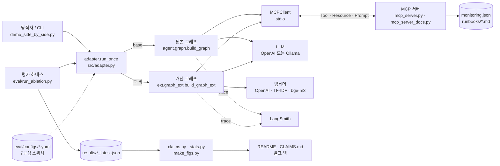
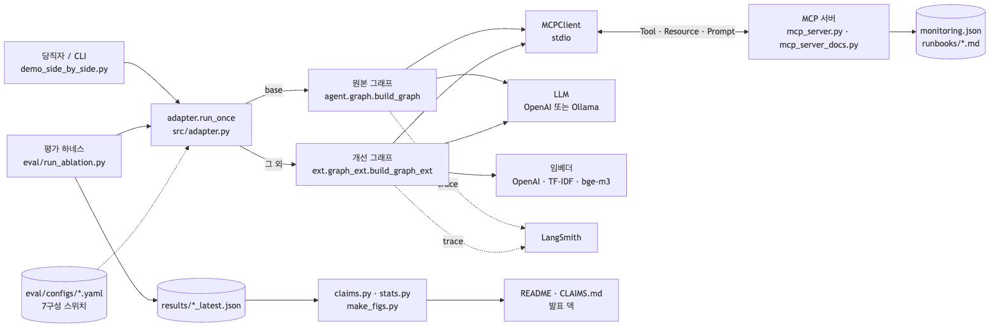
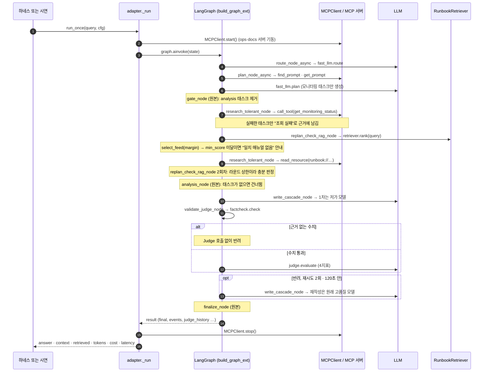
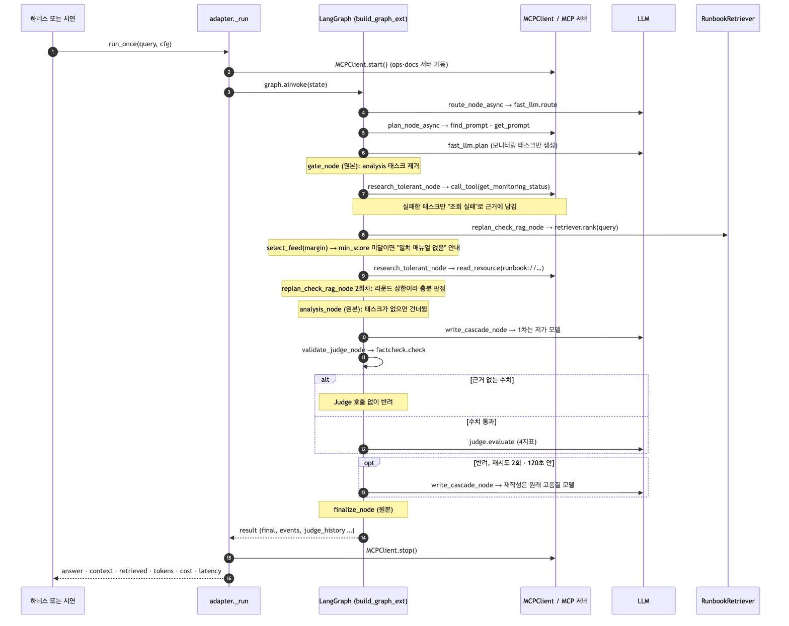
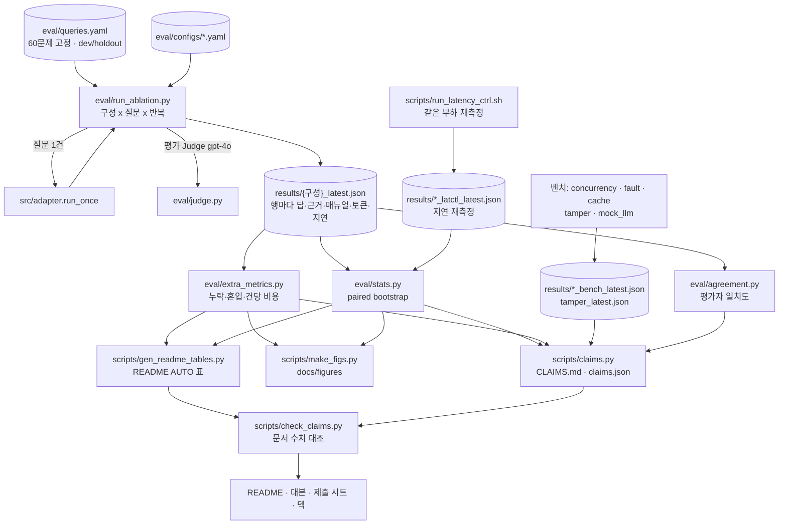
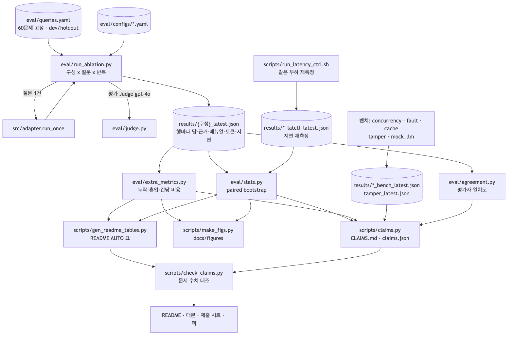

# 08 코드 가이드: 원본 위에 무엇을 어떻게 얹었나

이 문서는 코드를 처음 읽는 사람을 위한 안내서다. 채점자, 면접관, 그리고 나중의 나를 독자로 잡았다.
폴더 구조, 시스템 구조, 원본과 교체한 코드, 개선이 연결되는 지점, 작업 순서를 코드 리뷰처럼 따라간다.

> **수치는 이 문서에 거의 쓰지 않는다.** 결과 수치는 [README 3장](../README.md#3-구현-결과)과 [CLAIMS.md](../CLAIMS.md)에 있다.
> 이 문서에 나온 수치는 모두 CLAIMS.md의 값이고, 괄호 안에 CLAIMS id를 붙였다.
> 줄 번호는 이 문서를 커밋한 시점의 파일 기준이다. 줄이 밀렸으면 함수 이름으로 찾으면 된다.

**목차** · [1. How to Run](#1-how-to-run) · [2. 폴더 지도](#2-폴더-지도) · [3. 시스템 아키텍처](#3-시스템-아키텍처) · [4. 요청 하나의 여정](#4-요청-하나의-여정) · [5. 원본 vs 교체 노드](#5-원본-vs-교체-노드) · [6. 재사용 호출 트리와 핵심 코드](#6-재사용-호출-트리와-핵심-코드) · [7. 평가 하네스 흐름](#7-평가-하네스-흐름) · [8. 개발 진행 STEP](#8-개발-진행-step) · [9. 핵심 인사이트](#9-핵심-인사이트) · [10. 한계와 코드 부채](#10-한계와-코드-부채)

---

## 1. How to Run

**환경:** macOS · Python 3.12 · `.venv` · OpenAI API(본 실험) 또는 로컬 Ollama(사내망 시험)
**모든 명령은 저장소 루트에서 실행한다.** LangSmith 기록이 필요 없으면 앞에 `LANGCHAIN_TRACING_V2=false`를 붙인다.

<details>
<summary><b>최초 1회: 가상환경과 키 설정 (펼치기)</b></summary>

```bash
python3 -m venv .venv
.venv/bin/pip install -r requirements.txt   # src/requirements.txt(원본 의존성) + 평가 하네스 의존성

# OpenAI 키를 화면에 표시하지 않고 .env 에 저장한다 (.env 는 커밋되지 않는다)
scripts/set_keys.sh
```

로컬 Ollama로만 돌릴 때는 키가 필요 없다. 아래 4번만 보면 된다.

</details>

**① 오프라인 테스트 (키 없음, 비용 0)**

```bash
LANGCHAIN_TRACING_V2=false .venv/bin/python -m pytest -q
make reproduce-offline   # 테스트 + 저장된 results/ 로 통계·표·그림·CLAIMS 재계산 + 문서 수치 대조
```

**② 시연: 같은 질문을 원본과 최종에 나란히 (실제 API)**

```bash
.venv/bin/python scripts/demo_side_by_side.py --id Q01      # DB 다운 질문 (평가셋 id)
.venv/bin/python scripts/demo_side_by_side.py --id Q19      # 맞는 매뉴얼이 없는 질문
.venv/bin/python scripts/demo_side_by_side.py "질문 문장"    # 직접 입력
.venv/bin/python scripts/demo_side_by_side.py --render results/demo/demo_q01_20261021_114804.json   # API 없이 그림만
```

기본값은 `--left base --right final`이다. 다른 구성끼리 비교하려면 두 옵션에 구성 이름을 준다.

**③ 전체 Ablation (실제 API, 비용 발생)**

```bash
.venv/bin/python -m eval.run_ablation --all --backend fake --no-judge   # 키 없이 배관만 점검 (저장 안 함)
.venv/bin/python -m eval.run_ablation --config eval/configs/rag.yaml --ids Q01,Q16 --no-save   # 일부만
scripts/run_all.sh               # 7구성 x 60문제 x 3회 + 벤치 3종 + 결과표
make reproduce-full CONFIRM=yes  # 위 + 지연 통제 재측정 + 오프라인 재계산 (비용 확인용 안전장치 포함)
```

<details>
<summary><b>개별 벤치·분석 명령 (펼치기)</b></summary>

```bash
.venv/bin/python -m eval.concurrency_bench                 # 동시 요청 (기본 N=1,3,5,10)
.venv/bin/python -m eval.concurrency_bench --backend fake_slow   # 모의 지연 LLM, API 없음
.venv/bin/python -m eval.fault_bench                       # 모니터링 조회 일부를 일부러 실패시킴
.venv/bin/python -m eval.fault_bench --backend fake        # API 없음
.venv/bin/python -m eval.cache_bench --config eval/configs/final.yaml
.venv/bin/python -m eval.tamper_test                       # 조작 테스트, 코드 검증만 (비용 0)
.venv/bin/python -m eval.mock_llm_bench                    # 모의 LLM 서버 장애 주입 (비용 0)
.venv/bin/python -m eval.stats --split holdout             # 질문 단위 paired bootstrap
.venv/bin/python scripts/claims.py && .venv/bin/python scripts/check_claims.py
```

</details>

**④ 로컬 Ollama (사내망 시험, 키 없음)**

```bash
# 터미널 1: Ollama 서버 (앱이 떠 있으면 생략)
ollama serve
```

```bash
# 터미널 2: 모델 받고 실행
ollama pull qwen3:8b && ollama pull bge-m3
.venv/bin/python -m eval.calibrate_rag --embedding ollama:bge-m3                  # dev 24문제로만 기준값 보정
.venv/bin/python -m eval.ollama_demo --configs final_local_bge,base --qid Q01     # 질문 1개 비교
.venv/bin/python -m eval.ollama_holdout --configs base,final_local_bge           # holdout 전체 (오래 걸림, 이어 하기 지원)
.venv/bin/python -m eval.ollama_holdout_summary --a base_local --b final_local_bge
```

**원본 서버 그대로 띄워 보기:** `scripts/run_base_original.sh` (기본 fake 백엔드). `LLM_BACKEND=ollama`를 주면 원본의 Ollama 경로로 돈다. 기록은 `docs/evidence/`에 남는다.

---

## 2. 폴더 지도

표시: **[원본]** 교수님 제공 코드(이식 커밋 `55e15f1` 이후 변경 없음) · **[추가]** 이번 과제에서 만든 것

```text
incident-agent-ablation/
├── README.md                 [추가] 최종 보고서 (결과·그림·교훈)
├── CLAIMS.md                 [추가] 문서에 나오는 모든 수치와 출처·분모·재현 명령 (scripts/claims.py 가 생성)
├── CLAUDE.md                 [추가] 작업 규칙: 수치 추정 금지, 원본 보존, 평가셋 고정, 무한 루프 가드
├── Makefile                  [추가] reproduce-offline / reproduce-full / check
├── PROGRESS.md               [추가] 작업 진행판 (scripts/board.py 로 터미널 표시)
├── requirements.txt          [추가] src/requirements.txt + 평가 의존성
├── pytest.ini                [추가]
│
├── src/                      에이전트 본체
│   ├── BASE_ORIGIN.md        [추가] 원본 출처·이식 방법 (바이트 동일 확인)
│   ├── adapter.py            [추가] 평가·시연의 단일 진입점 run_once(). base 면 원본 그래프, 아니면 ext 그래프
│   ├── agent/                [원본] LangGraph Supervisor
│   │   ├── graph.py          [원본] 노드 10개 + build_graph (route→plan→gate→research→replan_check→analysis→write→validate→finalize)
│   │   ├── deps.py           [원본] SupervisorDeps (노드에 partial 로 주입하는 의존성 묶음)
│   │   ├── openai_llm.py     [원본] OpenAI Fast/Quality LLM (route·plan·analyze·chat·write)
│   │   ├── ollama_llm.py     [원본] 같은 인터페이스의 Ollama 구현
│   │   ├── fake_llm.py       [원본] 키 없이 도는 결정적 LLM (오프라인 테스트에 사용)
│   │   ├── mcp_client.py     [원본] MCP stdio 클라이언트 (ops·docs 서버 2개, 첫 조회 1회 일부러 타임아웃)
│   │   ├── retry.py          [원본] with_retry: TimeoutError 만 지수 백오프 재시도
│   │   ├── session_store.py  [원본] SQLite 세션 (FastAPI 서버용, 평가에서는 안 씀)
│   │   └── supervisor_v1.py  [원본] v1 Supervisor (평가에서는 안 씀)
│   ├── ext/                  [추가] 교체 노드와 부품. 원본을 import 해서 감싸거나 대체한다
│   │   ├── graph_ext.py      [추가] build_graph_ext: 같은 엣지, 플래그로 노드 6개 교체
│   │   ├── rag.py            [추가] RunbookRetriever + 임베더 4종 (OpenAI·글자 n-gram·TF-IDF·Ollama)
│   │   ├── judge.py          [추가] 파이프라인 Judge 4지표 (v1·v2 프롬프트), FakeJudge
│   │   ├── factcheck.py      [추가] 답의 수치가 근거에 있는지 코드로 대조
│   │   ├── meter.py          [추가] 토큰·비용 계측, 429/5xx 재시도, 질의 캐시(QueryCache)
│   │   ├── faults.py         [추가] FaultyMCP: 도구 호출 일부를 결정적으로 실패시킴
│   │   └── slow_fake.py      [추가] 동기 지연을 넣은 fake LLM (동시성 메커니즘 검증용)
│   ├── mcp_server.py         [원본] ops MCP 서버: Tool get_monitoring_status · Resource runbook://… · Prompt incident_analysis_prompt
│   ├── mcp_server_docs.py    [원본] docs MCP 서버 (에이전트는 쓰지 않는 미끼 서버)
│   ├── data/                 [원본] monitoring.json(시스템별 상태) + runbooks/*.md(매뉴얼 6개)
│   ├── server.py             [원본] FastAPI /health·/chat·/chat/stream
│   ├── web_chat.html · web_demo_server.py   [원본] 브라우저 데모
│   ├── sh/ · doc/            [원본] 실행 스크립트와 교수님 매뉴얼
│   └── README.md             [추가] src 안내
│
├── eval/                     [추가] 평가 하네스 (모두 추가 코드)
│   ├── queries.yaml          고정 평가셋 60문제 (dev Q01~Q24 · holdout Q25~Q60, gold 매뉴얼·must_include)
│   ├── configs/*.yaml        7구성(base…final) + 로컬 데모 구성 2개 (final_local, final_local_bge)
│   ├── run_ablation.py       구성 x 질문 x 반복 실행 → results/{구성}_latest.json
│   ├── judge.py              평가 Judge (gpt-4o, 파이프라인 Judge 와 분리)
│   ├── retrieval_metrics.py · answer_metrics.py · extra_metrics.py   검색·답변·운영 지표 (사후 계산)
│   ├── stats.py · report.py  paired bootstrap · 비교표
│   ├── agreement.py · claude_labels.yaml · human_*   평가자 일치도 (독립 AI 평가자·사람 라벨 준비)
│   ├── concurrency_bench.py · fault_bench.py · cache_bench.py · mock_llm_bench.py · tamper_test.py   벤치
│   ├── calibrate_rag.py      최소 유사도 기준값을 dev 로만 보정
│   ├── exclude_reps.py       오염된 반복을 사유와 함께 집계에서 빼기
│   ├── external/             외부 블라인드 문항 (개발에 관여하지 않은 출처, 실행 전에 고정)
│   └── ollama_demo.py · ollama_holdout.py · ollama_holdout_summary.py · retrieval_local_holdout.py   로컬 실행
│
├── scripts/                  [추가] 실행·집계·문서 생성
│   ├── run_all.sh · run_latency_ctrl.sh · run_bench_reps.sh · run_base_original.sh
│   ├── demo_side_by_side.py  원본·최종 나란히 시연 + 그림 렌더
│   ├── claims.py · check_claims.py · gen_readme_tables.py · make_figs.py · latency_summary.py
│   ├── label.py · human_labels.py   사람 라벨링 도구
│   └── set_keys.sh · log.sh · board.py · build_presentation_script.py · make_short_deck.py · canva_fonts.py
│
├── results/                  [추가] 실행 결과 (보고서 근거라 커밋한다, raw/ 만 제외)
│   ├── {구성}_latest.json · {구성}_<날짜_시각>.json   본 측정
│   ├── {구성}_latctl_latest.json   지연 통제 재측정
│   ├── stats_*.json · claims.json · *_bench_*.json · tamper_* · calibrate_rag*.json · ollama_*
│   └── demo/                 시연 그림의 입력 JSON
│
├── tests/                    [추가] 키 없이 도는 오프라인 테스트 (fake 백엔드)
├── docs/                     [추가] 개선계획(00) → 평가설계(01) → 실험로그(02) → … → 회고(07) → 이 문서(08)
│   ├── figures/              README 그림 (scripts/make_figs.py, demo_side_by_side.py 가 생성)
│   ├── evidence/             원본 서버 실행 기록
│   ├── research/             실태 현황 조사
│   └── 발표/                 발표 대본·용어집·시연 가이드
└── deck/                     [추가] 발표 덱 생성기와 최종 PPTX·PDF
```

**원본을 고치지 않았다는 근거:** `git log --format=%h -- src/agent src/mcp_server.py src/data src/server.py`를 돌리면 이식 커밋 `55e15f1` 하나만 나온다. 개선은 모두 `src/ext/`와 `src/adapter.py`에 있다.

---

## 3. 시스템 아키텍처





읽는 법:
- 사람(시연)이든 하네스(평가)든 **입구는 `run_once` 하나**다. 구성 YAML이 어떤 그래프와 부품을 쓸지 정한다.
- 개선 스위치가 하나도 켜져 있지 않으면 원본 `build_graph`를 그대로 부른다. 그래서 `base`가 원본 동작의 기준선이 된다.
- MCP 서버는 질의마다 새로 띄우고 닫는다. 질의 사이에 상태가 섞이지 않는다.
- LLM은 OpenAI 호환 `/v1/chat/completions` 하나로 나간다. 로컬 실행은 이 주소만 Ollama로 바꿔 끼운다.

---

## 4. 요청 하나의 여정

`final` 구성으로 장애 질문 1건이 지나가는 순서다. 노드 이름 옆은 실제로 실행되는 함수다. 원본 함수는 `graph.py`, 교체 함수는 `graph_ext.py`에 있다.





짚을 점:
- **매뉴얼은 plan이 아니라 replan_check가 고른다.** 원본 `plan`은 모니터링 태스크만 만든다(`openai_llm.py`의 `plan`). 첫 research 뒤에 매뉴얼이 없으면 replan_check가 매뉴얼 태스크를 추가하고 research로 되돌린다. 그래서 이 노드 하나를 바꾸는 것으로 매뉴얼 선택 전체가 바뀐다.
- **되돌아가는 고리는 두 개다.** replan_check → research는 라운드 1회 상한(원본 규칙 그대로)이고, validate → write는 Judge 가드(재시도 2회 또는 120초)로 끝난다.
- min_score에 걸려 넣을 매뉴얼이 없으면 gap 태스크가 0개라 바로 analysis로 간다. 대신 "일치 매뉴얼 없음" 안내가 근거(`collected`)에 들어가 write가 되묻게 된다.

---

## 5. 원본 vs 교체 노드

`build_graph_ext`(`src/ext/graph_ext.py:321`)는 원본 `build_graph`(`src/agent/graph.py:310`)와 엣지·조건 분기가 같다. 아래 노드만 스위치에 따라 바뀐다.

| 노드 | 원본 함수 (file:line) | 교체 함수 (file:line) | 켜는 스위치 (config key) |
|---|---|---|---|
| route | `route_node` (`src/agent/graph.py:76`) | `route_node_async` (`src/ext/graph_ext.py:104`) | `runtime.async_io` |
| plan | `plan_node` (`src/agent/graph.py:102`) | `plan_node_async` (`src/ext/graph_ext.py:113`) | `runtime.async_io` |
| gate | `gate_node` (`src/agent/graph.py:123`) | 교체 없음 | - |
| research | `research_node` (`src/agent/graph.py:138`) | `research_tolerant_node` (`src/ext/graph_ext.py:130`) | `runtime.tolerant_research` |
| replan_check | `replan_check_node` (`src/agent/graph.py:217`) + `_classify_incident_type` (`:205`) | `replan_check_rag_node` (`src/ext/graph_ext.py:190`) + `RunbookRetriever.rank` (`src/ext/rag.py:192`) · `select_feed` (`src/ext/rag.py:205`) | `runbook_selection: rag`, 보완 `rag.min_score` · `rag.notices` |
| analysis | `analysis_node` (`src/agent/graph.py:234`) | 교체 없음 | - |
| write | `write_node` (`src/agent/graph.py:255`) | `write_cascade_node` (`src/ext/graph_ext.py:236`) | `cost.model_tiering` |
| write · chat (LLM 호출) | `OpenAIQualityLLM.write` 안의 동기 `httpx.post` | `ThreadedWriter` (`src/ext/graph_ext.py:79`) | `runtime.async_io` |
| validate | `validate_node` (`src/agent/graph.py:275`) | `validate_judge_node` (`src/ext/graph_ext.py:256`) + `OpenAIJudge.evaluate` (`src/ext/judge.py:101`) · `factcheck.check` | `validator: judge`, 보완 `judge.version: 2` · `judge.factcheck` |
| route · plan (LLM 결과) | `OpenAIFastLLM.route` · `plan` | `MeteredFastLLM.route` (`src/ext/meter.py:226`) · `plan` (`:235`) 캐시 적중 시 LLM 생략 | `cost.cache` |
| finalize · chat_answer | `finalize_node` (`:292`) · `chat_answer_node` (`:86`) | 교체 없음 | - |

구성별로 켠 스위치는 `eval/configs/*.yaml`에 있고, 요약은 [README 1.4](../README.md#14-구현개선한-핵심-기능)에 있다.

---

## 6. 재사용 호출 트리와 핵심 코드

개선판은 원본을 새로 쓰지 않았다. 원본 함수를 import 해서 그대로 쓰거나 감싼다. 화살표는 "부른다", `(원본)`은 `src/agent` 코드다.

```text
eval/run_ablation.py · scripts/demo_side_by_side.py
    │ run_once(query, cfg)
    ▼
src/adapter.py  run_once → _run
    ├── MCPClient().start()                               (원본) mcp_client.py
    │     └── [fault_injection] FaultyMCP(mcp)            ext/faults.py
    ├── _build_deps(cfg) → ExtDeps(SupervisorDeps)        ext/graph_ext.py ← (원본) deps.py
    │     ├── MeteredFastLLM / MeteredQualityLLM          ext/meter.py ← (원본) OpenAIFastLLM·OpenAIQualityLLM 상속
    │     ├── OpenAIJudge                                 ext/judge.py ← (원본) OpenAILLM 상속
    │     └── RunbookRetriever(embedder, cache)           ext/rag.py
    ├── _is_base(cfg) ?
    │     ├── 예  → build_graph(deps)                     (원본) graph.py, 노드 10개 전부 원본
    │     └── 아니오 → build_graph_ext(deps)              ext/graph_ext.py
    │             ├── 원본 그대로: gate_node · analysis_node · finalize_node · chat_answer_node
    │             │               _after_route · _after_replan_check · _after_validate (분기 함수)
    │             ├── 원본 호출로 감쌈: write_cascade_node → write_node(원본)
    │             └── 원본 로직 복사 + 수정: route/plan_node_async · research_tolerant_node
    │                                       replan_check_rag_node · validate_judge_node
    └── graph.ainvoke(state) → 결과 dict (answer · context · retrieved · tokens · cost · latency)
```

### 코드 1. 원본과 개선판의 갈림길 (`src/adapter.py:145`, `:183`)

```python
def _is_base(cfg: dict) -> bool:
    """개선 스위치가 하나도 켜지지 않았는지. ... (docstring 일부 생략)"""
    return (cfg.get("runbook_selection", "keyword") == "keyword"
            and cfg.get("validator", "rule") == "rule"
            and not cfg.get("cost", {}).get("model_tiering")
            and not cfg.get("cost", {}).get("cache")
            and not any(cfg.get("runtime", {}).values()))
```

```python
        graph = build_graph(deps) if _is_base(cfg) else build_graph_ext(deps)
        state = {"query": query, "thread_id": f"eval-{uuid.uuid4().hex[:8]}", "history": [],
                 "events": [], "cost_usd": 0.0, "started_at": time.monotonic()}
        if _is_base(cfg):
            state.pop("started_at")   # 원본 AgentState 에 없는 키는 넣지 않는다
```

> **코드 리뷰.** 무엇을 하나: 스위치가 모두 꺼진 구성은 원본 그래프로 보내고, 원본 상태에 없던 키도 빼고 넣는다. 왜 이렇게: `base`가 "원본 동작 그대로"여야 Ablation의 기준선이 성립한다. 원본 파일을 고치는 대신 입구에서 분기했다. 한계: LLM 클래스는 base에서도 `MeteredFastLLM`류(계측·재시도 래퍼)를 쓴다. 요청 내용은 원본과 같지만 HTTP 타임아웃과 429 재시도는 원본과 다르다. "그래프와 노드는 원본, LLM 호출 계층은 계측판"이 정확한 표현이다.

### 코드 2. 같은 엣지, 노드만 교체 (`src/ext/graph_ext.py:343`)

```python
    g = StateGraph(ExtState)
    node = lambda fn: partial(fn, deps=deps)
    g.add_node("route", node(route_node_async if rt.get("async_io") else route_node))
    g.add_node("chat_answer", node(chat_answer_node))
    g.add_node("plan", node(plan_node_async if rt.get("async_io") else plan_node))
    g.add_node("gate", node(gate_node))
    g.add_node("research", node(research_tolerant_node if rt.get("tolerant_research") else research_node))
    g.add_node("replan_check", node(replan_check_rag_node if use_rag else replan_check_node))
    g.add_node("analysis", node(analysis_node))
    g.add_node("write", node(write_cascade_node if use_cascade else write_node))
    g.add_node("validate", node(validate_judge_node if use_judge else validate_node))
    g.add_node("finalize", node(finalize_node))
```

> **코드 리뷰.** 무엇을 하나: 노드 이름과 엣지는 원본과 같고, 노드에 꽂는 함수만 스위치로 고른다. 왜 이렇게: 스위치 하나를 켜고 끈 두 구성의 차이가 곧 그 개선의 기여도가 된다. 원본의 의존성 주입(`partial(fn, deps=deps)`) 방식을 그대로 따랐다. 한계: 이 아래의 엣지 정의는 원본 `build_graph`를 복사했다. 원본 그래프 구조가 바뀌면 두 곳을 같이 고쳐야 한다.

### 코드 3. 매뉴얼을 "덜 넣는" 규칙 (`src/ext/graph_ext.py:197`)

```python
    rag = deps.cfg.get("rag", {})
    # 1) 질의 임베딩으로 런북 순위 top_k (Recall@k·MRR 은 이 순위로 잰다)
    ranking = await _call(deps, deps.retriever.rank, state["query"], rag.get("top_k", 3))
    # 2) 1위 점수 - margin 이내만 투입 후보 (복합 장애면 2개, 단일이면 대개 1개)
    fed = select_feed(ranking, margin=rag.get("margin", 0.05))

    # v2 — 최소 유사도, 안내 문구
    notices = []
    min_score = rag.get("min_score")
    if min_score is not None:
        # 3) 절대 기준: 유사도가 rag.min_score 미만이면 '맞는 런북 없음'으로 본다. margin 은 1위와의
        #    상대 거리라서, 1위 자체가 엉뚱한 경우(미등록·모호 질의)를 거르지 못한다.
        #    값은 dev 질의만으로 eval/calibrate_rag.py 가 정했고, 임베더마다 척도가 달라 구성마다 다르다.
        fed = [rid for rid, s in ranking if rid in fed and s >= min_score]
        if not fed:
            notices.append(f"등록된 런북 중 질문과 일치하는 절차가 없음 (최고 유사도 {ranking[0][1]:.3f} < "
                           f"기준 {min_score:.3f}). 추측한 절차를 쓰지 말고, 확인한 모니터링 범위만 전한 뒤 "
                           f"대상 시스템과 증상을 되물을 것.")
```

> **코드 리뷰.** 무엇을 하나: 원본은 모니터링 경고 문구의 키워드로 매뉴얼 1개를 골랐다. 여기서는 질문 문장을 임베딩해 순위를 매기고, 1위와 가까운 것만 넣고, 최소 유사도보다 낮으면 아무것도 넣지 않는다. 대신 "맞는 매뉴얼 없음"을 근거에 적어 write가 되묻게 한다. 왜 이렇게: 1차 실측에서 RAG는 누락을 줄였지만 엉뚱한 매뉴얼 혼입은 그대로였다. 혼입을 줄인 것은 이 몇 줄(v2)이다. 한계: `min_score`는 임베더마다 척도가 달라 임베더를 바꾸면 다시 보정해야 한다. dev로 정한 경계가 얇다는 점도 README 4.1에 적었다.

### 코드 4. 코드 검증 먼저, LLM 검수 나중, 그리고 가드 (`src/ext/graph_ext.py:279`)

```python
    # 평가 Judge 와 같은 근거 원문(write 가 받은 '수집된 사실')으로 검증한다
    fc = factcheck(draft, context) if jcfg.get("factcheck") else None
    if fc is not None and not fc["ok"]:
        # 근거 없는 수치 — LLM Judge 를 부르지 않고 코드에서 바로 반려
        res = {"verdicts": {m: ("Fail" if m == "completeness" else "Pass") for m in METRICS},
               "reasons": {m: (f"근거에 없는 수치 {fc['unsupported']}" if m == "completeness" else "")
                           for m in METRICS},
               "fixable": True}   # 수치는 근거 안에서 고칠 수 있으므로 재작성 대상
        score, ok, by = 0.0, False, "factcheck"   # score 0 = Judge 를 거치지 않은 코드 반려 표시
    else:
        res = await _call(deps, deps.judge.evaluate, state["query"], context, draft)
        n_pass = sum(1 for m in METRICS if res["verdicts"][m] == "Pass")
        # 3/4 규칙: threshold 0.75 면 Pass 3개(0.75) 이상 합격. 지표 하나의 흔들림으로 재작성하지 않게 한다
        score, ok, by = n_pass / len(METRICS), n_pass / len(METRICS) >= threshold, "judge"
    verdict = "합격" if ok else "불합격"

    guard = None
    if not ok:
        elapsed = time.monotonic() - state.get("started_at", time.monotonic())
        if not res.get("fixable", True):
            guard = "근거 밖 요구 — 재작성 생략"
        elif attempts - 1 >= max_retries:   # attempts-1 = 지금까지 재작성 횟수
            guard = f"재시도 상한 {max_retries}회"
        elif elapsed >= max_seconds:
            guard = f"시간 상한 {max_seconds}초"
        if guard:
            ok, verdict = True, f"통과 처리({guard})"
```

> **코드 리뷰.** 무엇을 하나: 답에 근거 없는 수치가 있으면 Judge를 부르지 않고 코드로 반려한다. 아니면 Judge가 4지표를 매긴다. 반려되어도 "고칠 수 없음 · 재시도 상한 · 시간 상한" 중 하나에 닿으면 멈춘다. 왜 이렇게: 수치는 코드가 정확하고 싸게 잡는다. 무한 루프 가드는 CLAUDE.md 규칙대로 횟수와 시간을 둘 다 둔다. 한계: 시간 상한은 판정이 끝날 때만 확인한다. 진행 중인 LLM 호출은 끊지 않아서 상한을 조금 넘길 수 있다. 그래서 `adapter.py`에 질의 전체 상한(`HARD_TIMEOUT_S`)을 바깥 울타리로 따로 두었다. 또 가드로 "통과 처리"된 답은 사용자에게 경고 없이 나간다. 기록(`judge_history`)에만 남는다.

### 코드 5. 원본의 숨은 병목과 우회 (`src/agent/openai_llm.py`, `src/ext/graph_ext.py:74`)

원본 write는 `async def`인데 안에서 동기 HTTP를 부른다. 아래는 원본 `openai_llm.py`의 두 군데를 발췌한 것이다(`...`는 생략).

```python
# src/agent/openai_llm.py:212 (원본)
    async def write(self, query: str, collected: list[dict], attempt: int,
              feedback: str | None, on_token=None) -> tuple[str, dict]:
        ...
        content, usage = self._chat(system, user)

# src/agent/openai_llm.py:98 (원본, _chat 안)
        resp = httpx.post(OPENAI_URL, json=payload, headers=headers, timeout=120.0)
```

개선판은 그 호출을 스레드로 뺀다 (`ThreadedWriter`는 docstring·`__init__` 생략).

```python
async def _call(deps: ExtDeps, fn, *args):
    """async_io 면 동기 함수를 스레드에서 돌려 이벤트 루프를 막지 않는다."""
    return await asyncio.to_thread(fn, *args) if _async_io(deps) else fn(*args)


class ThreadedWriter:
    ...
    def __getattr__(self, item):
        return getattr(self._inner, item)

    async def write(self, *args, **kwargs):
        return await asyncio.to_thread(asyncio.run, self._inner.write(*args, **kwargs))
```

> **코드 리뷰.** 무엇을 하나: route·plan·judge처럼 동기 메서드는 `to_thread`로, write·chat처럼 "겉만 async"인 메서드는 스레드 안에서 새 이벤트 루프로 돌린다. 왜 이렇게: 노드가 async여도 안에서 동기 호출을 하면 같은 루프의 다른 요청이 모두 기다린다. 원본 LLM 클래스를 고치지 않고 바깥에서 감쌌다. 한계: 근본 해결은 `httpx.AsyncClient`로 바꾸는 것이다. 지금 방식은 호출마다 스레드와 이벤트 루프를 하나씩 만든다. `ThreadedWriter`가 `__getattr__`로 나머지를 위임하므로, 원본 LLM에 새 async 메서드가 생기면 우회 없이 루프를 막는다.

---

## 7. 평가 하네스 흐름





원칙 세 가지가 코드로 박혀 있다.
- **평가셋 고정과 holdout 분리.** holdout 문제는 개선 v2 코드보다 먼저 커밋했다(`6eb9482` → `c0ec157`). 기준값 보정(`calibrate_rag.py`)은 dev만 읽는다.
- **채점자 분리.** 파이프라인 Judge(gpt-4o-mini)와 평가 Judge(gpt-4o)를 다른 모델로 둔다(`eval/run_ablation.py` 머리말). Judge와 무관한 코드 지표(누락·혼입·핵심 문구)로 결론을 낸다.
- **손으로 옮긴 숫자 없음.** README 표와 그림, CLAIMS는 결과 파일에서 생성하고, `check_claims.py`가 문서 속 수치를 허용 목록과 대조한다.

---

## 8. 개발 진행 STEP

`git log --reverse` 기준이다. 굵은 글씨는 에이전트 기능 개선이다. 검증 칸은 커밋 본문의 근거를 옮겼다.

| STEP | 날짜 | 커밋 | 한 일 | 검증 |
|:--:|:--|:--|:--|:--|
| 01 | 10-20 18:05 | `68ba927` `79c0345` | 평가 하네스 뼈대 먼저: Judge 4지표·재시도/시간 가드, Recall@k·MRR, 구성별 실행기, 인수인계 문서 | 원본 받기 전 구조만 |
| 02 | 10-21 10:04 | `55e15f1` `69deb06` | 교수님 원본을 `src/`에 변경 없이 이식, fake 백엔드로 1회 실행 | `diff -rq` 차이 없음, `docs/evidence/base_original_fake.txt` |
| 03 | 10-21 10:07 | `6b1b518` | 평가셋 v2 24문제(실제 매뉴얼 id, must_include), 키 입력 스크립트 | YAML 로드·카테고리 수·gold가 매뉴얼 6종 안에 있는지 확인 |
| 04 | 10-21 10:20 | **`e1e92e9`** `9e683fe` | **adapter 단일 진입점 + 개선 3축(RAG · Judge · 캐스케이드/캐시)을 플래그로 구현** | pytest (fake 백엔드), fake 백엔드 전 구성 실행 오류 0 |
| 05 | 10-21 10:29 | `5590317` | 코드 리뷰 반영: Judge 오류 격리, Recall@3 편향 보정(투입 매뉴얼 기준 지표 추가), 라벨 정합성 | pytest (회귀 테스트 추가) |
| 06 | 10-21 10:47 | `74b92cb` `83b1273` | 4구성 1차 실측, Judge와 무관한 must_include 지표 도입, 결과 분석(평가 Judge 포화 발견) | 실행 오류 0 |
| 07 | 10-21 10:55 | `080c274` `56b2d9d` `d415b22` | 덱 생성기(수치는 results에서 읽음), README를 결과 보고서로, 수치 검증 지적 반영 | 검증 에이전트 대조 |
| 08 | 10-21 11:16 | `6eb9482` | 평가셋 v3: holdout 36문제 추가, 개선 v2 구현 전에 고정 | 기존 24문제는 split 외 동일 |
| 09 | 10-21 11:36 | **`c0ec157`** | **개선 v2: 최소 유사도·안내, Judge v2(fixable), factcheck, 도구 부분 실패 허용, 비동기 I/O + 7구성·3회 반복 체계** | pytest, fake 백엔드 7구성 배관 확인, 원본 `src/agent` 변경 없음 |
| 10 | 10-21 11:49 | `f1ba93f` | 나란히 시연 스크립트, 운영 언어 지표(누락·혼입·건당 비용)와 편향 검증, `run_all.sh` | `demo --id Q01` 실행 기록 |
| 11 | 10-21 11:58 | `99f2ca6` | 7구성 x 60문제 x 3회 실측, 질문 단위 paired bootstrap | 실행 오류 0 (`runs_total`) |
| 12 | 10-21 12:15 | `99c80d1` `606af8e` `b8b81a3` | 반복 사이 캐시 잔존 버그 수정, 429 대응(Retry-After), 캐시 벤치 | 회귀 테스트가 수정 전 실패·수정 후 통과 |
| 13 | 10-21 13:07 | `40c9a8b` `a31212b` | 사람 라벨 표본·라벨링 가이드, 독립 평가자(Claude) 블라인드 60건으로 평가 Judge 관대함 측정 | 일치도 집계 (`rater_*`) |
| 14 | 10-21 15:24 | `01bc12c` `f230443` `2886df2` | 동시성·장애 주입 벤치(모의 → 실제 API), 오염 반복 제외 집계, 캐스케이드 구성 cold 3회 재측정 | 반복별 캐시 적중 0 확인 |
| 15 | 10-21 16:20 | `b2e5d45` `96380b7` `4fa6409` `7ae1dc2` | 그림 9종 자동 생성, README 재구성, 5분 발표 덱·대본 | 그림 수치는 results에서 |
| 16 | 10-22 09:01 | `ab5b9c4` `7a380e9` `655d546` | 요약 인포그래픽, 실태 현황 조사(국외·국내·논문·현업 MCP), 검증 지적 반영 | 교차 조사 |
| 17 | 10-22 10:24 | **`9faeab4`** `b815653` | **지연 통제 재측정: 7구성을 같은 부하로 다시 재고 지연 결론 정정** | 실행 오류 0 (`latctl_runs`) |
| 18 | 10-22 10:34 | **`be47aca`** `521cd40` | **CLAIMS.md 자동 생성 + 문서 수치 대조기, `make reproduce-offline/full`** | 문서 수치 대조 불일치 0 |
| 19 | 10-22 10:38 | `f17b028` `9923aac` `09ecd60` `f953c08` | 사람 라벨링 파일, 조작 테스트(코드 검증 vs Judge), 모의 LLM 서버 장애 주입 벤치 | `tamper_*`, `mock_*` |
| 20 | 10-22 11:30 | `ab8c396` `d446b38` `3662287` | 벤치 `--tag`, 동시성 5회·고장 위치 5가지 반복 측정 | `conc_10_reps`, `fault_reps` |
| 21 | 10-22 12:45 | **`88fe1ec` `9238ae4` `80931b7` `e4124fd`** | **로컬 Ollama: 원본 실행 증빙, 개선판 데모, 로컬 기준값 재보정·TF-IDF 임베더, bge-m3 임베더와 holdout 검색 단독 평가** | dev 보정 결과 파일, 원본 코드 수정 없음 |
| 22 | 10-22 13:57 | `b983dd6` `6d65e32` `2140407` | 로컬 holdout 36문제 실행기(이어 하기)·요약기, base_local · final_local_bge 결과 | 두 구성 모두 오류 0 |
| 23 | 10-22 13:03 | `7ab1f2c` … `9a7509d` | 발표 PDF·용어집·대본·Q&A, 발표 자료 정리 | 발표 (13:10) |
| 24 | 10-22 16:09 | `63875b4` `b0bedda` `f127a34` `fa943a3` `5fed83e` | 매뉴얼 없는 질문 시연 그림, 용어 통일, 외부 블라인드 문항 고정(실행 전 커밋), `src/ext`·adapter 주석 보강 | `--render` 재생성, 문서 수치 대조 0건 |

흐름을 한 줄로 줄이면 이렇다. **측정 장치를 먼저 만들고(01~03) → 개선을 플래그로 얹고(04, 09) → 측정이 틀릴 수 있는 지점을 하나씩 고쳤다(05, 12, 13, 17, 18).**

---

## 9. 핵심 인사이트

**01 | 검색 하나가 답의 품질을 정했다.**
원본은 질문이 아니라 모니터링 경고 문구로 매뉴얼을 골랐다. replan_check 한 노드를 RAG로 바꾸자 맞는 매뉴얼 누락이 유의하게 줄었다 (-46%p, `pair_rag_miss`). 매뉴얼 선택이 이 노드 하나에 몰려 있다는 것을 코드에서 먼저 확인한 덕분에 바꿀 곳이 한 곳이었다.

**02 | 더 넣기보다 덜 넣는 규칙이 혼입을 줄였다.**
RAG만으로는 엉뚱한 매뉴얼 혼입이 그대로였다. "충분히 비슷하지 않으면 넣지 않고 되묻는다"는 몇 줄(v2)이 혼입을 줄였다 (-24%p, `pair_v2_wrong`). 기준값은 dev로만 정했고 holdout에서도 효과가 유지됐다.

**03 | LLM 검수자는 품질을 올리지 못했다. 쓸모는 다른 곳에 있었다.**
파이프라인 Judge를 켜도 품질 향상은 확인되지 않았고 지연과 비용만 늘었다 (`lat_judge`). 대신 조작 테스트에서 역할이 갈렸다. 코드 검증은 수치 조작을 잡고, Judge는 코드가 못 잡는 없는 시스템명을 잡았다 (`tamper_num`, `tamper_name`). 그래서 v2에서 "수치는 코드로 먼저, 나머지는 Judge"로 순서를 정했다.

**04 | 채점하는 AI도 검증 대상이다.**
평가 Judge(gpt-4o)는 거의 모든 구성에 후하게 합격을 줬다. 독립 평가자가 불합격으로 본 답의 다수를 합격시켰다 (`rater_lenient`). 그래서 결론은 코드로 센 지표로 냈다. 파이프라인 Judge와 평가 Judge를 다른 모델로 둔 것도 같은 이유다.

**05 | 측정 조건이 결론을 바꾼다.**
반복 사이에 캐시가 남아 2회차가 유리하게 나왔다. 일부 구성만 다른 부하에서 재서 캐스케이드가 지연도 줄인 것처럼 보였다. 같은 조건으로 다시 재자 그 효과는 사라졌다 (`lat_cascade`). 회귀 테스트와 재측정 스크립트가 이 교훈을 코드로 남긴 것이다.

**06 | 모델을 바꾸면 기준값도 다시 정해야 한다.**
로컬 Ollama로 옮길 때 코드는 주소만 바꾸면 됐다. 하지만 OpenAI 임베딩으로 정한 최소 유사도를 그대로 쓰자 매뉴얼을 하나도 고르지 못했다 (`local_first_final`). 임베더마다 점수 척도가 다르다. 바꿔 끼울 곳은 LLM 주소, 임베더, 기준값 세 곳이다.

---

## 10. 한계와 코드 부채

코드를 다시 읽으며 찾은 점이다. 이 문서에서는 고치지 않고 기록만 한다.

| # | 위치 | 내용 | 영향 | 개선 방향 |
|---|---|---|---|---|
| 1 | `src/ext/graph_ext.py` `route_node_async` · `plan_node_async` · `research_tolerant_node` · `replan_check_rag_node` | 원본 노드 본문을 복사해 일부만 바꿨다. 원본을 고치지 않는 규칙 때문이다 | 원본 로직이 바뀌면 복사본이 어긋난다. 테스트가 두 경로를 다 봐야 한다 | 원본에 훅이 없으니 지금은 감수. 원본을 고칠 수 있게 되면 LLM 호출·태스크 실행을 주입 지점으로 분리 |
| 2 | `src/ext/graph_ext.py` `build_graph_ext` | 엣지 정의를 원본 `build_graph`에서 복사 | 그래프 구조 변경 시 두 곳 수정 | 원본이 노드 사전을 받는 빌더였다면 엣지 공유 가능 |
| 3 | `eval/ollama_demo.py` · `eval/ollama_holdout.py` · `eval/mock_llm_bench.py` | 실행 중에 `httpx.post`, `OPENAI_URL`, `EMBED_URL`, `PRICE`를 모듈 전역에서 바꿔 끼운다(몽키패치) | 같은 프로세스의 다른 코드도 영향을 받는다. import 순서에 기대는 코드가 생겼다(`ollama_holdout.py`가 `_real_post`를 먼저 잡도록 import) | LLM 주소·타임아웃을 구성(`cfg`)으로 받는 클라이언트 계층 |
| 4 | `src/ext/graph_ext.py` `ThreadedWriter` | 호출마다 스레드 안에서 `asyncio.run`으로 새 이벤트 루프를 만든다. `__getattr__` 위임이라 새 async 메서드는 우회되지 않는다 | 호출당 오버헤드, 숨은 블로킹 위험 | `httpx.AsyncClient` 기반 LLM 클래스 |
| 5 | `src/ext/meter.py` `MeteredChatMixin` | base도 이 래퍼를 쓴다. 요청 내용은 원본과 같지만 타임아웃·429 재시도가 원본과 다르다 | "base = 원본 그대로"는 그래프·노드 수준의 말이다 | README·CLAIMS에 계측 계층 차이를 명시 |
| 6 | `src/agent/mcp_client.py` (원본) + `src/adapter.py` | 원본 MCPClient는 첫 모니터링 조회 1회를 일부러 타임아웃시킨다(재시도 시연용). adapter가 질의마다 클라이언트를 새로 만들어 모든 질의가 이 재시도를 한 번씩 겪는다 | 모든 구성에 같은 고정 지연이 더해진다. 구성 간 비교는 공정하지만 절대 지연은 그만큼 부풀려진다 | 평가에서는 `MCPClient(flaky_first_tool_call=False)` 선택지를 구성으로 노출 |
| 7 | `src/ext/graph_ext.py` `research_tolerant_node` | 원본의 태스크당 고정 대기(`asyncio.sleep`)를 그대로 복사 | 지연에 상수 성분, 원본과 같게 맞추려는 의도라 비교에는 영향 없음 | 상수를 원본에서 import |
| 8 | `src/ext/graph_ext.py:217` | 안내 문구에 기본 조회 시스템 이름(`auth-service`)을 문자열로 박았다. 실제 폴백은 원본 `_extract_system_name`·`plan` 프롬프트에 따로 있다 | 원본 폴백이 바뀌면 안내가 틀린다 | 폴백 값을 한 곳에서 읽기 |
| 9 | `src/ext/judge.py` `SYSTEM` · `SYSTEM_V2`, `facts_from_collected` | 프롬프트 v1·v2가 대부분 같은 문장을 두 번 쓴다. `facts_from_collected`는 원본 `write`의 사실 정리 형식을 복사했다 | 형식이 바뀌면 근거 추출이 어긋난다 | 공통 문장 조립, 형식 함수 공유 |
| 10 | `src/ext/judge.py` `OpenAIJudge.evaluate` | JSON 파싱에 실패하면 4지표를 모두 Fail로 보고 `fixable`은 참이 된다 | 모델 출력 오류가 재작성으로 이어진다(가드가 막지만 비용·지연 발생) | 파싱 실패를 별도 상태로 기록하고 재작성 대신 재판정 |
| 11 | `src/ext/graph_ext.py` `validate_judge_node` | 가드로 "통과 처리"된 답에 사용자용 표시가 없다 | 검수에 실패한 답이 평범한 답처럼 나간다 | 최종 답에 "검수 미통과" 표시를 붙이는 옵션 |
| 12 | `src/ext/rag.py` `_INDEX` | 매뉴얼 벡터를 임베더 이름으로 프로세스 전역에 캐시한다. `LocalTfidfEmbedder`는 이름이 고정이다 | 매뉴얼 폴더를 바꿔도 같은 프로세스에서는 옛 색인을 쓴다 | 키에 매뉴얼 해시 포함 |
| 13 | `src/adapter.py` · `eval/run_ablation.py` | 하네스가 adapter의 비공개 전역 `_CACHES`를 직접 비운다. adapter는 `sys.path`를 조작해 `src`를 import 경로에 올린다 | 모듈 경계가 약하다 | `reset_caches()` 공개 함수, 패키지 설치형 구조 |
| 14 | `eval/run_ablation.py` `_T95` | t 분포 값을 자유도 5(반복 6회)까지만 표로 박았다. 그 이상은 1.96으로 근사 | 반복을 늘리면 구간이 조금 좁게 나온다 | `scipy.stats.t` 또는 표 확장 |
| 15 | `src/ext/factcheck.py` | 값만 대조하고 무슨 값인지는 보지 않는다. 시스템 이름 같은 비수치 환각은 못 잡는다 | 조작 테스트에서 확인된 한계 (`tamper_name`) | 항목·단위까지 대조, 시스템명은 MCP 재조회로 확인 |
| 16 | 전반 | 매직 넘버가 구성과 코드에 흩어져 있다: `HARD_TIMEOUT_S`, Judge 가드 기본값, 재시도 횟수·대기, 로컬 타임아웃 | 실험 조건을 한눈에 보기 어렵다 | 런타임 상수를 구성 한 곳으로 |

범위 밖으로 둔 것: 라우터(route)는 개선하지 않았다. FastAPI 서버(`src/server.py`)와 세션 저장소는 원본 그대로이며 평가 경로에 들어가지 않는다.

---

<sub>그림 `docs/figures/code_*.png`는 이 문서의 mermaid 블록을 mermaid-cli로 그린 것이다. GitHub에서는 mermaid 블록이 그대로 렌더된다.</sub>
